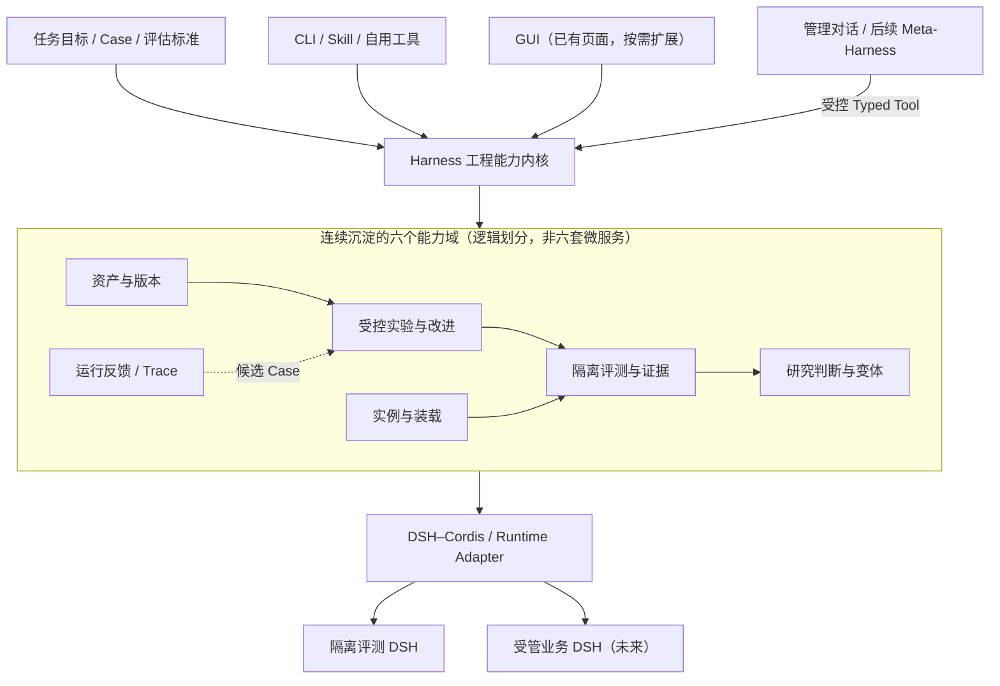
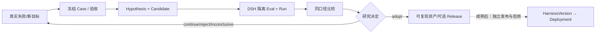

# 01｜Harness 工程平台总体概要设计

> 设计级别：概要设计（HLD）；定义能力、边界、阶段和主要数据流。实现状态见项目验收矩阵。

## 1. 项目定位

`ai-agent-harness` 正在建设基于 DSH 的 Harness 工程平台，围绕实际需求持续交付资产、评测、实例和工具管理能力，并吸收经过验证的研究成果。目标是持续改善垂域任务的**质量、成本、稳定性、可复现性**。

后续目标包括以 **LUI / Meta-Harness** 为首选交互、以确定性服务承载管理与优化，以及让多个独立 DSH Agent 实例执行真实任务。当前页面与能力的实现状态见项目验收矩阵。

**理念**：“任务与验收 → Harness → Runtime”，基础设施服务于实际操作。平台实现与必要研究持续结合，复用已有 CLI、资产和证据。用户应感受到“复杂性留给平台，操作尽可能简单”。

## 2. 目标与不可协商约束

| 类别 | 设计目标 | 不是这个目标 |
|---|---|---|
| Harness 工程 | 以真实 Case 和运行证据驱动可解释改进 | 模型自评即证明有效；默认自动合并 Candidate |
| 版本与资产 | 固定来源、内容摘要、装载快照和可恢复资产 | `Git HEAD` 当业务已发布版本 |
| 变体 | 以明确任务集合/资源预算/关键退化红线研究等效边界 | 固定 T0–T3 四套共用 Plugin 的模板 |
| 实例 | 单 Agent 标准镜像、只读 Harness、独立 HOME、真实探针 | Docker running/HTTP 200 即“智能体可用” |
| 交互 | 最终可由 CLI、GUI、LUI 访问同一业务能力 | 为管理 Agent 再造一套具有隐式高权限的服务 |
| 数据 | 每项可编辑事实唯一写入口，历史证据可核查 | Git↔PG 双向编辑、复制所有 Session 事件为第二权威 |
| 运维 | 先单人内网，异常真实返回 unknown、可对账恢复 | 初期完整权限矩阵/分布式一致性基础设施 |

## 3. 利益相关者与典型用户故事

**研究开发者（当前）**：给定失败业务 Case，建立 Experiment/候选差异，调用真实 `dsh-eval`，比较改善与退步，给出 `adopt/continue/reject/inconclusive`，能用冻结来源重跑。

**平台使用者（当前）**：通过六个页面及现有 CLI 管理 Agent 来源、资产、评测 Run、实例与 MCP 工具，核对操作回执和已有证据。

**平台管理员（未来）**：在首页问“找出这次错误、准备改进并跑对照”，接收精确对象选择、差异预览、确认卡与证据回执；管理已发布 Harness 及受管 DSH 实例。

**业务用户（更远期 G2）**：只能使用对自己开放、真实可用的 Agent；新 Session 固定已启用版本，旧 Session 不随默认版本改变。

## 4. 能力架构与先后依赖

六个能力域按任务、写权和证据划分，可由一个进程、一个工具链实现多项能力。

## 5. 产品信息架构（目标态）

- **默认首屏**：无侧栏 LUI，任务输入与最近真实任务；用户按需进入管理 GUI。
- **工作区导航**：Agent / Harness 资产，实验与评测，变体，DSH 实例，对话和 Trace，反馈问题，能力 Hub（MCP/Skill/Plugin/知识），版本与启用，设置运维。
- **目标态不代表初期菜单**：R1–R3 可以完全没有 Web；R4 的首个 GUI 可先呈现资产、实验、实例、证据四个任务视图，LUI 后加。
- **首屏展示证据**：未接入的数据展示空态、未知态、上次观测时间，禁止使用草图中的虚构统计数字。

## 6. 概要非功能要求（渐进验收）

| 属性 | 当前/近期准则 | 产品化后补充条件 |
|---|---|---|
| 可靠性 | 真实输入、Run、出错与恢复证据；损坏时不覆盖旧 Run | 操作幂等、异步状态机、重启核对和 unknown |
| 可恢复 | Git commit 和 Run 可重查；实例 HOME 独立 | Git/PG/DSH/文件分别备份及隔离恢复演练 |
| 性能 | 测量 CLI 评测用时/步骤，性能优化必须有基线 | 列表、Trace 查询延迟和分位数由实际用户要求决定 |
| 可扩展 | 当前 DSH-only，适配锁定镜像与协议 | 多宿主、专用搜索由实际瓶颈触发；仍限 DSH，其他 Runtime 须先明确改变项目使命 |
| 安全 | LLM Key 不入远端 Git、Run、Trace；不执行未知插件/归档 | 多用户时服务端身份/归属校验；模型工具不持有任意 Docker/SQL 权限 |
| 可维护 | 小修改、少依赖、已有 CLI 复用、无一次性抽象 | 一条业务能力由一个 Service 实现，多个 UI 只是适配器 |

## 7. 一条贯穿各阶段的主业务链

工作流每一段都可以通过 CLI 验证；不需要等待前端或 PostgreSQL 才能成立。研究 `adopt`、研究 Release、平台 `published`、实例 `loaded`、新会话 `enabled` 分别是不同事实。

## 8. 范围与关键取舍

**当前选定需求优先**：平台功能按实际问题实施与验证；涉及 Harness 效果时保留研究比较与证据定位，有真实反馈时做问题转 Case。只有资源/组件变化属于当前假设时才做变体样本。阶段条件引用 [05](05_实施路线与迭代计划.md)，比较环境引用 [03](03_存储架构与数据契约.md#comparison-environment)。

**有真实重复收益再做**：统一命令、实例/Run 搜索、差异预览、可重复的跨工具链、稳定的数据索引。

**按独立需求扩展**：在已有 DSH Profile、页面和管理对话之上，按需要选择共用 Service、PG Operation/Invocation、MCP 市场/画布、Harness 发布与业务启用；已有局部能力不代表这些完整目标均已交付。

**暂不做**：通用 workflow engine、长期独立外部研究系统、事件双写默认化、自动变体转换/路由、审批引擎、多租户多节点。

## 9. 对原始任务来源的解释原则

[原任务清单](sources/DSH智能体运行平台开发任务清单_2026-10-09.md)中的 112 项任务是**目标产品的功能合同候选**。其中 `MG01–05`、`IN01–08`、`SE01–05` 的 G1a 分级表示建设平台时优先。实施时按 [05](05_实施路线与迭代计划.md) 的阶段条件选择任务；原 ID、原 G 级别及最早基础能力、UI 阶段的映射见 [08](08_112项任务追溯矩阵.md)。

## 10. 适用范围与执行入口

本概要设计定义平台目标与演进路径，具体实施由当前需求与任务范围确定；业务 Harness 研究继续使用研究流程。当前能力与证据见[项目验收矩阵](../ai-agent-harness项目验收矩阵.md)；设计的适用边界见 [10](10_项目核心声明与执行边界.md)，工作选择与决策记录见 [12](12_阶段决策与实际执行协议.md)。
