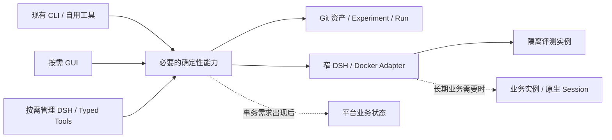

# 02｜系统架构、部署与 DSH 接入设计

## 1. 当前入口与未来形态

当前研究路径复用 Git 资产、Experiment、Run、`dsh-dev` 和 `dsh-eval`。哪些合同已经验证、哪些仍有限制，以[项目验收矩阵](../ai-agent-harness项目验收矩阵.md)为准。本章给出后续形态，不将其描述为已部署系统。

这些是逻辑责任，允许同一进程和少量函数承载。阶段与进入条件只在 [05](05_实施路线与迭代计划.md)维护，数据写权只在 [03](03_存储架构与数据契约.md)维护。

## 2. 最小责任边界

| 能力 | 责任 | 引入条件 |
|---|---|---|
| Asset/Evaluation | 解析固定来源，定位唯一 Case/Candidate，调用评测并读取冻结 Run | 先复用现有 CLI；第二消费者确实出现才提取公共能力 |
| Instance Adapter | 核对来源、镜像、只读挂载、独立 HOME 和实际观察 | 研究实例先满足当前合同；长期写操作另有真实需求 |
| Operation | 将已确认目标、执行结果和 unknown 对账关联起来 | GUI/Meta 等入口确需共享持久操作状态 |
| Session Binding/Invocation | 将业务请求定位到正确的 Runtime、Session 与 Turn | 真实长期业务会话出现 |
| Meta-Harness | 解释证据、准备计划，通过确定性服务执行 | 自然语言管理实测有益；不是首个工具的前置条件 |
| MCP Composer/Gateway | 执行开发者维护的业务组合定义，暴露实际可发现、可调用的 MCP 工具 | 按 [05 的组合路线](05_实施路线与迭代计划.md#mcp-composition-route)验证执行、发布与只读展示；职责不要求拆成独立服务 |

CLI、GUI、Meta 只适配输入与展示；同一业务写入调用同一实现。业务 Agent loop、SessionPersistence 和模型执行由 DSH 承担，不在仓库再复制 Runtime 内核。

## 3. 实例与镜像

同一业务 Agent 维护一个当前标准 DSH Runtime 镜像，新实例共享它。Prompt、Preset、Plugin 及可挂载依赖作为只读 Harness 资产加载；只有锁定 Runtime 改变或当前镜像与来源不一致时才重建标准镜像。

评测、管理和业务实例使用独立 HOME、Profile、运行配置与持久卷。删除容器不等于删除 HOME；旧实例的冻结来源不能随 dirty Candidate 漂移。容器 running、HTTP 200 和挂载存在分别只证明局部状态，实际装载和任务行为要用新进程或新 Session 核验。独立 HOME 隔离实例，不自动证明共享实例内的用户归属隔离，见 [04](04_核心业务闭环与服务接口.md#多用户数据边界与选型门槛)。

若启用容器管理，Docker Socket 仅由窄执行器接触，Meta 不取得自由 Docker/SQL 客户端或凭据值。凭据文件及 Git 边界遵循[根级规则](../../AGENTS.md)，不得进入模型上下文、普通日志或研究证据。

## 4. Profile、Preset 与开发身份

优先复用 DSH 的 Cordis、Profile、Preset、bundle、插件和适配器机制。显示它们的声明来源、覆盖关系、作用范围及实际装载；保存配置不表示插件已生效。Profile 改动可能影响共用它的其他 Session，应在明确 Candidate 和隔离环境中验证。`dispose` 或重启不能撤销已发生的外部副作用。

开发工具的身份与目标业务 Harness 分开。读取业务 `AGENTS.md` 是为了编辑资产；不能由此切换开发身份或覆盖业务指令。任务内选择已装载工具或知识源属于一次运行；Prompt、Preset、Skill、插件配置或适配器发生语义变化时才按研究合同创建 Experiment。管理或评审 Harness 自身发生变化，也要保留其来源。

## 5. 技术接入与语言迁移

首个工具复用现有 Python/Shell CLI、来源解析和 Run 记录。窄 Client 调用应核对工作目录、参数、结构化 stdout、诊断 stderr、退出码、超时和取消结果；进程启动、HTTP 受理或页面返回不能代替操作完成。`dry-run` 不应执行所预览的副作用。

新增自研功能使用 TypeScript，界面使用 TSX；按 DSH 装载方式生成 JavaScript/ESM，生成物不成为第二份可编辑源码。现有 Python 只在实际变更调用链中按功能切片迁移，保留 CLI、资产与 Run 语义，用受影响 Case、新 Session、构建和装载证据验证后替换。不将全仓语言重写作为工具启动条件。

管理界面可以由特化 DSH Profile/插件承载，调用同一确定性服务。只有现有扩展接口经原型证明不足，才考虑有记录、可回退的最小 Runtime 修改。一元 Remote 调用不能证明流式会话、取消和重连已经可用，这些要按锁定版本分别探测。

## 6. 复用已有 MCP 资产

[EXP-014](../../evolution/experiments/EXP-security-operations-expert-014-r8b1bd54e8be7/hypothesis.md)是已有单实例 MCP 管理资产的来源入口，实际结论须回到该实验的 Evaluation/Decision 核查。其接入边界应在新工具中延续：OpenAPI 规范地址用于生成 tools/resources；现成 MCP 服务使用 URL 和请求 Header；Web profile patch 是实例在线工作态，Candidate 种子用于新卷恢复。

未来跨实例管理读取现有 Candidate 与实际 profile，展示差异、实际版本和验证时间，通过已有插件修改；不维护另一套重叠的可编辑 MCP 清单。分组链接是配置的衍生结果。统一 Token 留在实例专用配置，不回流 Candidate 种子或模型上下文。跨实例目录、状态库和操作边界由实际用户故事决定。

## 7. 部署扩展条件

先维持单人研究的本地工具。长期业务 Agent、多 Agent 对外调用或独立用户出现后，才选择单机 Docker、业务 Gateway、持久平台状态等实现。统一入口必须验证服务端身份、Agent 与版本路由、流转发、取消、重连和 Session 粘性；浏览器 owner Token 不能代替业务用户身份。锁定 DSH 的入口不足时才评估最小 Host 插件桥。

多宿主、队列、专用检索和独立服务均需现实容量或故障边界证据。不存在消费者时不预建接口和目录。
