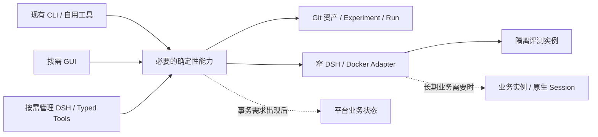

# 02｜系统架构、部署与 DSH 接入设计

## 1. 当前入口与未来形态

当前平台复用 Git 资产、Experiment、Run、`dsh-dev`、`dsh-eval` 和系统全局 DSH 的插件界面，在交付功能的同时支持 Harness 研究。启动与装载合同见[当前最小平台接入合同](#当前最小平台接入合同)。哪些合同已经验证、哪些仍有限制，以[项目验收矩阵](../ai-agent-harness项目验收矩阵.md)为准。除当前接入合同外，本章的后续形态属于设计方向，不表示已经部署。



这些是逻辑责任，允许同一进程和少量函数承载。阶段与进入条件只在 [05](05_实施路线与迭代计划.md)维护，数据写权只在 [03](03_存储架构与数据契约.md)维护。

## 2. 最小责任边界

| 能力 | 责任 | 引入条件 |
|---|---|---|
| Asset/Evaluation | 解析固定来源，定位唯一 Case/Candidate，调用评测并读取冻结 Run | 先复用现有 CLI；第二消费者确实出现才提取公共能力 |
| Instance Adapter | 核对来源、镜像、只读挂载、独立 HOME 和实际观察 | 研究实例先满足当前合同；长期写操作另有真实需求 |
| Operation | 将已确认目标、执行结果和 unknown 对账关联起来 | GUI/Meta 等入口确需共享持久操作状态 |
| Session Binding/Invocation | 将业务请求定位到正确的 Runtime、Session 与 Turn | 真实长期业务会话出现 |
| Meta-Harness | 解释证据、准备计划，通过确定性服务执行 | 自然语言管理实测有益；不是首个工具的前置条件 |
| MCP Composer/Gateway | 执行开发者维护的业务组合定义，暴露实际可发现、可调用的 MCP 工具 | 按 [05 的组合路线](05_实施路线与迭代计划.md#mcp-composition-route)验证执行、发布与只读展示；职责不要求拆成独立服务 |

CLI、GUI、Meta 只适配输入与展示；同一业务写入调用同一实现。业务 Agent loop、SessionPersistence 和模型执行由 DSH 承担，不在仓库再复制 Runtime 内核。

## 3. 实例与镜像

同一业务 Agent 维护一个当前标准 DSH Runtime 镜像，新实例共享它。Prompt、Preset、Plugin 及可挂载依赖作为只读 Harness 资产加载；只有锁定 Runtime 改变或当前镜像与来源不一致时才重建标准镜像。

评测、管理和业务实例使用独立 HOME、Profile、运行配置与持久卷。删除容器不等于删除 HOME；旧实例的冻结来源不能随 dirty Candidate 漂移。容器 running、HTTP 200 和挂载存在分别只证明局部状态，实际装载和任务行为要用新进程或新 Session 核验。独立 HOME 隔离实例，不自动证明共享实例内的用户归属隔离，见 [04](04_核心业务闭环与服务接口.md#多用户数据边界与选型门槛)。

若启用容器管理，Docker Socket 仅由窄执行器接触，Meta 不取得自由 Docker/SQL 客户端或凭据值。凭据文件及 Git 边界遵循[根级规则](../../AGENTS.md)，不得进入模型上下文、普通日志或研究证据。

## 4. Profile、Preset 与开发身份

优先复用 DSH 的 Cordis、Profile、Preset、bundle、插件和适配器机制。显示它们的声明来源、覆盖关系、作用范围及实际装载；保存配置不表示插件已生效。Profile 改动可能影响共用它的其他 Session，应在明确 Candidate 和隔离环境中验证。`dispose` 或重启不能撤销已发生的外部副作用。

开发工具的身份与目标业务 Harness 分开。读取业务 `AGENTS.md` 是为了编辑资产；不能由此切换开发身份或覆盖业务指令。任务内选择已装载工具或知识源属于一次运行；Prompt、Preset、Skill、插件配置或适配器发生语义变化时才按研究合同创建 Experiment。管理或评审 Harness 自身发生变化，也要保留其来源。

## 5. 技术接入与语言迁移

首个工具复用现有 Python/Shell CLI、来源解析和 Run 记录。窄 Client 调用应核对工作目录、参数、结构化 stdout、诊断 stderr、退出码、超时和取消结果；进程启动、HTTP 受理或页面返回不能代替操作完成。`dry-run` 不应执行所预览的副作用。

新增自研功能使用 TypeScript，界面使用 TSX；按 DSH 装载方式生成 JavaScript/ESM，生成物不成为第二份可编辑源码。现有 Python 只在实际变更调用链中按功能切片迁移，保留 CLI、资产与 Run 语义，用受影响 Case、新 Session、构建和装载证据验证后替换。不将全仓语言重写作为工具启动条件。

管理界面可以由特化 DSH Profile/插件承载，调用同一确定性服务。只有现有扩展接口经原型证明不足，才考虑有记录、可回退的最小 Runtime 修改。一元 Remote 调用不能证明流式会话、取消和重连已经可用，这些要按锁定版本分别探测。

## 6. 复用已有 MCP 资产

[EXP-014](../../evolution/experiments/EXP-security-operations-expert-014-r8b1bd54e8be7/hypothesis.md)是已有单实例 MCP 管理资产的来源入口，实际结论须回到该实验的 Evaluation/Decision 核查。其接入边界应在新工具中延续：OpenAPI 规范地址用于生成 tools/resources；现成 MCP 服务使用 URL 和请求 Header；Web profile patch 是实例在线工作态，Candidate 种子用于新卷恢复。

未来跨实例管理读取现有 Candidate 与实际 profile，展示差异、实际版本和验证时间，通过已有插件修改；不维护另一套重叠的可编辑 MCP 清单。分组链接是配置的衍生结果。统一 Token 留在实例专用配置，不回流 Candidate 种子或模型上下文。跨实例目录、状态库和操作边界由实际用户故事决定。

## 7. 部署扩展条件

先维持单人研究的本地工具。长期业务 Agent、多 Agent 对外调用或独立用户出现后，才选择单机 Docker、业务 Gateway、持久平台状态等实现。统一入口必须验证服务端身份、Agent 与版本路由、流转发、取消、重连和 Session 粘性；浏览器 owner Token 不能代替业务用户身份。锁定 DSH 的入口不足时才评估最小 Host 插件桥。

多宿主、队列、专用检索和独立服务均需现实容量或故障边界证据。不存在消费者时不预建接口和目录。

## 当前最小平台接入合同

平台直接运行系统全局 `dsh`，使用 DSH 原生 Web Profile 和 Cordis 插件组合；本仓库不安装或复制 DSH Runtime。业务评测容器继续使用其独立的 `source.lock.json`，平台全局 DSH 的兼容性由 [`platform/plugin/package.json`](../../platform/plugin/package.json) 的 `peerDependencies` 声明；启动器读取这份声明检查现场版本，不维护另一份平台版本锁。

```text
platform/
  profile/                  # 平台 Profile 与插件组合的可编辑来源
  dsh-platform              # 准备、预览和前台启动入口
  plugin/                   # TypeScript Host、客户端和构建入口
  skills/                   # 平台管理对话装载的 DSH Skill
agents/                     # 已有业务 Agent 研究资料
evolution/experiments/      # 已有 Experiment、candidate 和 Run
```

`platform/` 集中维护平台启动约定、Profile 和独立的 DSH 插件包。业务 Harness 仍在各 Experiment 的 `candidate/` 维护。平台查询直接读取 `agents/` 与 `evolution/experiments/`；不另建 `platform/data/`、可编辑索引或研究数据副本。

平台 HOME 默认是 `$XDG_STATE_HOME/ai-agent-harness/platform/dsh-home`，未设置 `XDG_STATE_HOME` 时使用 `~/.local/state/ai-agent-harness/platform/dsh-home`。它与用户通常使用的 DSH HOME、业务评测容器 HOME 分开。

平台启动器可从本地忽略文件 `platform/credentials/models.llm-api-key` 读取 JSON 字段映射，支持 `DEEPSEEK_API_KEY`、`LOCAL_LLM_BASE_URL` 和 `LOCAL_LLM_API_KEY`；已有进程环境优先，凭据不进入版本控制。平台模型默认配置在 [`platform/plugin/cordis.patch.yml`](../../platform/plugin/cordis.patch.yml) 中提供，原生用户设置可覆盖；业务容器的统一模型默认值由最后装载的 [`runtime-model.patch.yml`](../../runtime/adapters/dsh-container/runtime-model.patch.yml) 提供，不回写 Candidate。

平台装载组合以仓库 `platform/profile/` 为唯一可编辑来源，`prepare` 将其物化到平台 HOME 的 `profiles/harness-platform/`。其中仓库 `cordis.patch.yml` 渲染为 `harness-platform.patch.yml`，`start` 通过 DSH 原生 `--patch` 装载；这些产物只是运行副本，不在那里修改平台组合。同目录的原生 `cordis.patch.yml` 仅在缺失时初始化为 `[]`，由 DSH 维护欢迎流程、模型设置和 MCP 服务/分组等实例配置；再次 `prepare` 和重启都保留这些偏好。Session、设置、缓存、附件与认证状态留在独立 HOME，不回流为平台源码或研究资产。

| 命令 | 行为 |
| --- | --- |
| `./platform/dsh-platform prepare` | 检查全局 DSH，安装平台插件构建依赖，构建 Host 与客户端产物，生成平台 HOME 内的 Profile；首次使用及插件源码修改后执行。 |
| `./platform/dsh-platform start --dry-run` | 只读预览全局 DSH 来源与版本、平台 HOME、Profile、插件路径和监听参数；不生成配置、不启动服务。 |
| `./platform/dsh-platform start` | 检查版本兼容性、构建产物、Profile 与端口，前台启动全局 DSH；默认监听本机默认 IPv4 路由选定的地址，端口为 `3090`。 |
| `./platform/dsh-platform start --host 192.168.1.10 --port 3091` | 显式选择具体 IPv4 和端口；仅本机使用可设置 `--host 127.0.0.1`。 |

启动器从自身路径定位仓库，可从任意工作目录调用。默认地址选择只查询本机路由；无法确定时要求通过 `--host` 指定，不静默回退。DSH 当前版本要求具体监听地址，不支持 `0.0.0.0`。全局 DSH 缺失、插件产物缺失、版本不兼容、地址不可绑定或端口冲突时明确失败；不能把失败写成已启动。使用 `Ctrl+C` 停止，重新 `start` 复用同一平台 HOME。平台插件或 Profile 修改后重新 `prepare`，再停止和启动进程验证生效。

平台整站使用 `/hap/`，浏览器通过 `/hap/login` 输入平台账号；默认值及唯一可编辑配置位于 [`platform/credentials/admin.json`](../../platform/credentials/admin.json)。基址由 [`sites.json`](../../runtime/adapters/dsh-web/sites.json) 维护，平台 Profile 加载仓库的 WebServer 适配器，页面、资源、API、连接及 MCP 共享原生挂载路径；不修改系统全局 DSH 安装。根页面跳到新基址并保留查询参数，旧根协议入口不再提供服务。业务容器的访问合同见[实例访问规则](../../runtime/adapters/dsh-container/README.md#实例访问规则)。账号修改后重启生效，旧会话失效。认证插件使用原生必需入口 `web-runtime`：先安装密码认证，再委托已核对的全局 WebApp；账号或插件装载失败会终止启动。认证初始化、卸载及失败期间均不退回原生 Token 认证。

平台会话使用随机 Cookie，设置 `HttpOnly`、`SameSite=Strict` 和 30 天有效期；凭据服务仅在平台 HOME 保存会话摘要和账号摘要。重启保留未过期会话；`/hap/logout` 撤销当前会话。迁移保留原 Cookie Path，避免与已有浏览器会话产生同名重复 Cookie。首页、原生 API、平台 RPC 和 MCP Gateway 共用此认证，同时保留原生 Host/Origin 校验。原生 Token 链接与 Cookie 不获得平台权限；启动地址不带 Token，Cookie 与凭据不进入普通日志或项目证据。当前 HTTP 入口适用于受信任局域网；共享使用前修改默认密码。

平台通过现有客户端槽位跳过预览版说明，通过 Profile 关闭模型欢迎流程；无需反复点击“继续”或“稍后配置”。手动“设置 → 模型”仍可使用，局域网浏览器按该登录会话管理宿主设置；平台不修改全局 DSH 源码。

管理对话使用所选模型的真实凭据。DeepSeek 凭据和自定义 OpenAI 兼容提供商通过“设置 → 模型”保存；自定义提供商需要填写 API 地址、协议与密钥，并选择服务实际提供的模型。原生凭据服务在独立平台 HOME 的 `.credentials.yaml` 保存密钥，文件权限为 `0600`；模型地址、模型列表和凭据引用由用户 `cordis.patch.yml` 维护，均在再次 `prepare` 和重启后保留。平台不复制用户其他 DSH HOME 的凭据，也不将运行凭据回流至 Git、普通日志或研究证据。管理对话配置与业务评测容器的运行环境分别维护。

Host 使用受平台登录认证保护的 `/harness-platform` RPC 通道。`inventory` 保留只读资产清单合同，`home` 读取真实 Run 索引和当前实例、MCP 登记；写入操作按 `agents/`、`instances/`、`mcp/` 分流到功能模块。平台通过 DSH 官方 `shell.overlay` 槽位展示参考图的蓝白主题首页、导航和工具页，进入工具页显示平台侧栏。管理对话展示同一原生会话树，设置入口继续使用原生服务与弹窗。客户端由 `esbuild` 生成符合 DSH ModuleLoader 契约的产物，复用 DSH 共享 React，并使用名称正确的 SVG Logo。空数据、读取失败和未知状态分别显示。

| 页面 | 当前动作及唯一事实入口 |
| --- | --- |
| 首页 | 从资产查询与 `run_record.py index` 获取数量和最近 Run；实例/MCP 查询失败时保留明确错误，不显示成零。 |
| 管理对话 | 管理平台智能体的 DSH Session；工作区固定为当前项目仓库，使用标准模式，隐藏工作区与模式选择。原生会话侧栏默认收起、会话使用单列表；移除重复标题、侧栏品牌、DSH 欢迎标题及预览标签。新建、搜索、切换与会话草稿复用原生状态，保留侧栏展开和设置入口。 |
| 智能体管理 | 搜索并选择 Agent，以概览、Harness 资产、能力状态和运行情况查看研究版本。保留融合来源盘点、AI 方案确认、特性确认、资产校验编辑及实例启动闭环；所选版本与登记版本分开，评测与报告入口携带精确对象跳转。 |
| 评测中心 | 按测试用例、评测运行和结果比较组织工作区。用例保存回 Agent 的 `evaluation.md`；执行、取消和状态复用 `dsh-eval`，报告与比较读取原 Run，Decision 写回所选 Experiment。原生认证下载支持报告、单文件和完整 Run ZIP；采集与导出边界见 [Trace 合同](03_存储架构与数据契约.md#trace-contract)。 |
| 实例管理 | 对象是智能体 DSH 容器实例。直接调用 `dsh-dev` 获取实际状态、来源、镜像、挂载及 HOME。详情内提供 iframe 嵌入说明和代码复制，使用与访问入口相同的实际实例 URL。生命周期操作立即打开确认窗口，展示预览、取消、错误与执行回执；同名实例操作串行；批量操作返回每项回执。删除仅限已停止实例，删除容器与登记后复查 HOME，保留 Session、研究资产及历史 Run。 |
| MCP 管理 | 复用 EXP-018 的 MCP 配置管理插件源码，提供服务列表、工具与资源分组、工具与资源调试、工具组合编排四个页签。服务列表展示描述与启用状态，出站密码和凭据输入提供显示/隐藏按钮；已发布编排自动显示为只读服务，可勾选工具加入分组。通过原生配置表单管理 OpenAPI/MCP 地址、凭据及分组；编排侧边栏按全部编排、正在编辑、已发布列出工具，选择后查看草稿或发布版，保存编辑、dry 测试及发布。当前编排复用 LangGraph.js 的“查询资产→查询相关告警”两步只读流程；界面从编译图读取节点、边和映射，界面与 MCP Gateway 共用 `src/mcp/` 执行器。 |

资产树排除 Run、Session、缓存、Git、依赖目录、符号链接与 `*.llm-api-key`；二进制及超过 1 MiB 的文件只显示元信息。草稿 dry 在临时目录中叠加修改，检查 JSON/YAML 格式，再使用可信的 `dsh-eval --dry-run` 检查来源合同和评测计划；不执行 Candidate 代码、模型或业务工具，不启动实例、不创建 Run。缺少运行环境变量作为警告显示，不将其解释为已经可执行。弹窗的预览与直接应用保存都经过服务端 dry，摘要冲突时不覆盖原文件。

实例嵌入沿用实例本身的认证设置；平台登录状态不会自动传递到 iframe。访问地址须能被使用者浏览器访问，HTTPS、同站点登录和网页 CSP 按嵌入说明配置。生成或复制代码只证明地址与访问入口一致，不证明跨站 Cookie 或另一台设备的连通性。

MCP 服务与分组由复用插件的原生配置编辑器维护，唯一运行配置写入平台 Profile 的用户 `cordis.patch.yml`，不再维护平台第二份连接清单。源码入口固定在 `EXP-security-operations-expert-018-rfbf7fd53a340` 的 MCP 配置插件，构建时适配平台命名并共享 DSH React 与配置服务，业务 Candidate 保持原样。出站服务凭据、分组访问凭据与平台登录会话各按原有合同使用，不写入回执或普通日志；实例内部 MCP 配置继续按其 Candidate/Profile 合同维护。

固定组合通过平台登录认证下的 `/hap/api/harness-platform/mcp` 发布，支持 `initialize → notifications/initialized → tools/list → tools/call`。出站 MCP 调用使用协商版本和服务端颁发的 Session Header，接收 JSON 或有限 SSE 响应；总体超时和响应大小受限。Gateway 接收单条 JSON-RPC 消息，通知返回 `202`，仅提供该只读组合，不提供手工流程编辑器或持续服务端事件订阅。协议依据是 [MCP 2025-06-18 Streamable HTTP](https://modelcontextprotocol.io/specification/2025-06-18/basic/transports)。OpenAPI 支持范围由解析器和测试明确约束；不支持递归引用、组合 Schema 等完整 JSON Schema 能力，解析限制以错误与测试为准。

组合执行回执记录定义摘要、当前实现来源、规范与操作 Schema 摘要、步骤和错误。第一步失败或缺少真实资产 ID 时不执行第二步；保存声明或成功发现工具不表示外部业务已验收。实例挂载观察不表示所有声明能力已经生效；Run 页面只显示现有材料，不承诺实时 trace。

工具目录的唯一维护位置是 [`platform/mcp-compositions.json`](../../platform/mcp-compositions.json)，保留工具名称、标题、说明、接口流程、OpenAPI 连接及可编辑草稿与当前发布快照。编辑和测试显式选择编排及版本；保存、测试和发布核对目录摘要，拒绝并发变化，失败保留草稿和原发布版。新建编排复用当前两步 SDK 流程。SOC 流程分别选择资产和告警服务：`get_soc_asset_by_asset_id` 校验 `data.assetId` 后，将资产 ID 传给 `list_detect_alert`，查询近 30 天首页告警分组，同时显示总分组数、总告警数与实际查询范围。OpenAPI 对象查询参数按 `form/explode` 展开；业务响应须同时通过 HTTP、业务码及结果映射校验。发布必须通过服务端 dry 校验，不请求上游；成功后仅当前发布快照进入 Gateway 的 `tools/list` 与 `tools/call`，调用方需重新发现工具。目录变更直接回读，无需重启；SDK 代码变更仍需重新构建及装载，发布快照不冻结整个平台实现。

已发布工具从目录派生为服务列表中的“工具组合编排”服务，保留服务 ID `platform-compositions` 和模型可见名称 `compositions`；没有发布工具时不显示。该服务不能在服务列表另行编辑或保存到 Profile，草稿不进入服务工具清单。发布结果立即更新服务与分组候选工具，保留原生配置的未保存输入。分组只在原生 Profile 保存服务 ID 与勾选工具名，通过 `/hap/mcp/groups/<group-id>` 和统一 Bearer Token 提供给智能体；工具名沿用 `mcp__compositions__<tool-name>`，发现和调用复用平台 Gateway 的发布版入口及同一执行器。工具名称改变后需重新勾选并保存分组；工具发现成功不代表依赖接口已经可用。

组合的唯一流程实现是 [`compositionGraph()`](../../platform/plugin/src/mcp/executor.ts)，使用 LangGraph.js `StateGraph` 编译及执行，不配置 checkpointer，也不引入图编辑器或持久工作流。界面按所选草稿或发布版编译并展示对应服务、操作和参数映射。页面 dry 只检查输入、图编译和依赖连接登记，零上游请求、零节点执行；上游规格、参数映射和工具结果由实际执行另行验证。流程展示参考 [Langflow 的节点与流](https://docs.langflow.org/concepts-flows)，SDK 用法依据 [LangGraph.js Graph API](https://docs.langchain.com/oss/javascript/langgraph/graph-api)。

[`mcp-composition` Skill](../../platform/skills/mcp-composition/SKILL.md) 给出当前组合的修改、映射和验证方法；平台 Profile 启用宿主层 `skill-filesystem`，仅通过 `customSkillDirs` 装载 `platform/skills/`，由新管理 Session 的原生技能目录发现。原有 Preset 继续负责项目和用户技能。它是 DSH 管理对话的运行资产，与维护本仓库的 `.agents/skills/` 分开，不注入业务 Candidate。修改插件或装载组合后仍需 `prepare`、重启和新 Session 验证生效。

完整平台验收从准备、只读预览到真实全局 DSH 启动，经平台密码登录完成六页操作，停止和重启后来源一致。构建、HTTP `200`、受控 Cordis 载体上的浏览器操作和外部接口测试桩分别证明对应局部合同；实际证据、环境阻断和业务评测缺口集中写入 `PA-12` 及受影响路径。
