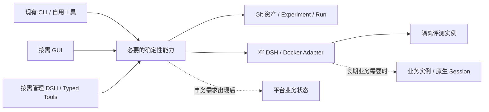

# 02｜系统架构、部署与 DSH 接入设计

## 1. 当前入口与未来形态

当前研究路径复用 Git 资产、Experiment、Run、`dsh-dev`、`dsh-eval` 和基于系统全局 DSH 的最小只读资产平台。当前平台的启动与装载合同见[当前最小平台接入合同](#当前最小平台接入合同)。哪些合同已经验证、哪些仍有限制，以[项目验收矩阵](../ai-agent-harness项目验收矩阵.md)为准。除当前接入合同外，本章的后续形态属于设计方向，不表示已经部署。



这些是逻辑责任，允许同一进程和少量函数承载。阶段与进入条件只在 [05](05_实施路线与迭代计划.md)维护，数据写权只在 [03](03_存储架构与数据契约.md)维护。

## 2. 最小责任边界

| 能力 | 责任 | 引入条件 |
|---|---|---|
| Asset/Evaluation | 解析固定来源，定位唯一 Case/Candidate，调用评测并读取冻结 Run | 先复用现有 CLI；第二消费者确实出现才提取公共能力 |
| Instance Adapter | 核对来源、镜像、只读挂载、独立 HOME 和实际观察 | 研究实例先满足当前合同；长期写操作另有真实需求 |
| Operation | 将已确认目标、执行结果和 unknown 对账关联起来 | GUI/Meta 等入口确需共享持久操作状态 |
| Session Binding/Invocation | 将业务请求定位到正确的 Runtime、Session 与 Turn | 真实长期业务会话出现 |
| Meta-Harness | 解释证据、准备计划，通过确定性服务执行 | 自然语言管理实测有益；不是首个工具的前置条件 |
| MCP Composer/Gateway | 执行开发者维护的业务组合定义，暴露实际可发现、可调用的 MCP 工具 | 按 [05 的组合路线](05_实施路线与迭代计划.md#mcp-composition-route)验证执行、发布与只读展示；职责不要求拆成独立服务 |

CLI、GUI、Meta 只适配输入与展示；同一业务写入调用同一实现。业务 Agent loop、SessionPersistence 和模型执行由 DSH 承担，不在仓库再复制 Runtime 内核。

## 3. 实例与镜像

同一业务 Agent 维护一个当前标准 DSH Runtime 镜像，新实例共享它。Prompt、Preset、Plugin 及可挂载依赖作为只读 Harness 资产加载；只有锁定 Runtime 改变或当前镜像与来源不一致时才重建标准镜像。

评测、管理和业务实例使用独立 HOME、Profile、运行配置与持久卷。删除容器不等于删除 HOME；旧实例的冻结来源不能随 dirty Candidate 漂移。容器 running、HTTP 200 和挂载存在分别只证明局部状态，实际装载和任务行为要用新进程或新 Session 核验。独立 HOME 隔离实例，不自动证明共享实例内的用户归属隔离，见 [04](04_核心业务闭环与服务接口.md#多用户数据边界与选型门槛)。

若启用容器管理，Docker Socket 仅由窄执行器接触，Meta 不取得自由 Docker/SQL 客户端或凭据值。凭据文件及 Git 边界遵循[根级规则](../../AGENTS.md)，不得进入模型上下文、普通日志或研究证据。

## 4. Profile、Preset 与开发身份

优先复用 DSH 的 Cordis、Profile、Preset、bundle、插件和适配器机制。显示它们的声明来源、覆盖关系、作用范围及实际装载；保存配置不表示插件已生效。Profile 改动可能影响共用它的其他 Session，应在明确 Candidate 和隔离环境中验证。`dispose` 或重启不能撤销已发生的外部副作用。

开发工具的身份与目标业务 Harness 分开。读取业务 `AGENTS.md` 是为了编辑资产；不能由此切换开发身份或覆盖业务指令。任务内选择已装载工具或知识源属于一次运行；Prompt、Preset、Skill、插件配置或适配器发生语义变化时才按研究合同创建 Experiment。管理或评审 Harness 自身发生变化，也要保留其来源。

## 5. 技术接入与语言迁移

首个工具复用现有 Python/Shell CLI、来源解析和 Run 记录。窄 Client 调用应核对工作目录、参数、结构化 stdout、诊断 stderr、退出码、超时和取消结果；进程启动、HTTP 受理或页面返回不能代替操作完成。`dry-run` 不应执行所预览的副作用。

新增自研功能使用 TypeScript，界面使用 TSX；按 DSH 装载方式生成 JavaScript/ESM，生成物不成为第二份可编辑源码。现有 Python 只在实际变更调用链中按功能切片迁移，保留 CLI、资产与 Run 语义，用受影响 Case、新 Session、构建和装载证据验证后替换。不将全仓语言重写作为工具启动条件。

管理界面可以由特化 DSH Profile/插件承载，调用同一确定性服务。只有现有扩展接口经原型证明不足，才考虑有记录、可回退的最小 Runtime 修改。一元 Remote 调用不能证明流式会话、取消和重连已经可用，这些要按锁定版本分别探测。

## 6. 复用已有 MCP 资产

[EXP-014](../../evolution/experiments/EXP-security-operations-expert-014-r8b1bd54e8be7/hypothesis.md)是已有单实例 MCP 管理资产的来源入口，实际结论须回到该实验的 Evaluation/Decision 核查。其接入边界应在新工具中延续：OpenAPI 规范地址用于生成 tools/resources；现成 MCP 服务使用 URL 和请求 Header；Web profile patch 是实例在线工作态，Candidate 种子用于新卷恢复。

未来跨实例管理读取现有 Candidate 与实际 profile，展示差异、实际版本和验证时间，通过已有插件修改；不维护另一套重叠的可编辑 MCP 清单。分组链接是配置的衍生结果。统一 Token 留在实例专用配置，不回流 Candidate 种子或模型上下文。跨实例目录、状态库和操作边界由实际用户故事决定。

## 7. 部署扩展条件

先维持单人研究的本地工具。长期业务 Agent、多 Agent 对外调用或独立用户出现后，才选择单机 Docker、业务 Gateway、持久平台状态等实现。统一入口必须验证服务端身份、Agent 与版本路由、流转发、取消、重连和 Session 粘性；浏览器 owner Token 不能代替业务用户身份。锁定 DSH 的入口不足时才评估最小 Host 插件桥。

多宿主、队列、专用检索和独立服务均需现实容量或故障边界证据。不存在消费者时不预建接口和目录。

## 当前最小平台接入合同

平台直接运行系统全局 `dsh`，使用 DSH 原生 Web Profile 和 Cordis 插件组合；本仓库不安装或复制 DSH Runtime。业务评测容器继续使用其独立的 `source.lock.json`，平台全局 DSH 的兼容性由 [`platform/plugin/package.json`](../../platform/plugin/package.json) 的 `peerDependencies` 声明；启动器读取这份声明检查现场版本，不维护另一份平台版本锁。

```text
platform/
  profile/                  # 平台 Profile 与插件组合的可编辑来源
  dsh-platform              # 准备、预览和前台启动入口
  plugin/                   # TypeScript Host、客户端和构建入口
agents/                     # 已有业务 Agent 研究资料
evolution/experiments/      # 已有 Experiment、candidate 和 Run
```

`platform/` 集中维护平台启动约定、Profile 和独立的 DSH 插件包。业务 Harness 仍在各 Experiment 的 `candidate/` 维护。平台查询直接读取 `agents/` 与 `evolution/experiments/`；不另建 `platform/data/`、可编辑索引或研究数据副本。

平台 HOME 默认是 `$XDG_STATE_HOME/ai-agent-harness/platform/dsh-home`，未设置 `XDG_STATE_HOME` 时使用 `~/.local/state/ai-agent-harness/platform/dsh-home`。它与用户通常使用的 DSH HOME、业务评测容器 HOME 分开。

平台装载组合以仓库 `platform/profile/` 为唯一可编辑来源，`prepare` 将其物化到平台 HOME 的 `profiles/harness-platform/`。其中仓库 `cordis.patch.yml` 渲染为 `harness-platform.patch.yml`，`start` 通过 DSH 原生 `--patch` 装载；这些产物只是运行副本，不在那里修改平台组合。同目录的原生 `cordis.patch.yml` 仅在缺失时初始化为 `[]`，由 DSH 维护欢迎流程、模型设置等实例偏好；再次 `prepare` 和重启都保留这些偏好。Session、设置、缓存、附件与认证状态留在独立 HOME，不回流为平台源码或研究资产。

| 命令 | 行为 |
| --- | --- |
| `./platform/dsh-platform prepare` | 检查全局 DSH，安装平台插件构建依赖，构建 Host 与客户端产物，生成平台 HOME 内的 Profile；首次使用及插件源码修改后执行。 |
| `./platform/dsh-platform start --dry-run` | 只读预览全局 DSH 来源与版本、平台 HOME、Profile、插件路径和监听参数；不生成配置、不启动服务。 |
| `./platform/dsh-platform start` | 检查版本兼容性、构建产物、Profile 与端口，前台启动全局 DSH；默认监听 `127.0.0.1:3090`。 |
| `./platform/dsh-platform start --port 3091` | 显式选择端口并按同一合同启动。 |

启动器从自身路径定位仓库，可从任意工作目录调用。全局 DSH 缺失、插件产物缺失、版本不兼容或端口冲突时明确失败；不能把失败写成已启动。使用 `Ctrl+C` 停止，重新 `start` 复用同一平台 HOME。平台插件或 Profile 修改后重新 `prepare`，再停止和启动进程验证生效。认证交接使用 DSH 原生方式，认证链接、Token 和 Cookie 不进入普通日志或项目证据。

Host 通过受 DSH 原生认证保护的 `/harness-platform` 查询通道提供只读 `inventory` 操作。首页使用 DSH 原生 `main` 与 `sidebar.panellist` 槽位，显示 Agent、Experiment、Run 的清单、数量、所属关系及仓库来源，提供刷新按钮；数据为空和读取失败分别显示。客户端由 `esbuild` 生成符合 DSH ModuleLoader 契约的产物，并复用 DSH 共享 React。查询过程不执行业务 Agent、不写入研究资产，也不需要 LLM API Key。

平台工具的完成标准是：从准备、只读预览到真实启动，经原生认证打开页面并完成 RPC 查询，清单与仓库一致，刷新有效，停止和重启后来源一致。构建、HTTP `200` 和插件声明只能证明各自局部状态；实际证据集中写入 `PA-12`。这个最小工具不证明后述修改、评测、管理智能体或业务运行流程已经实现。
