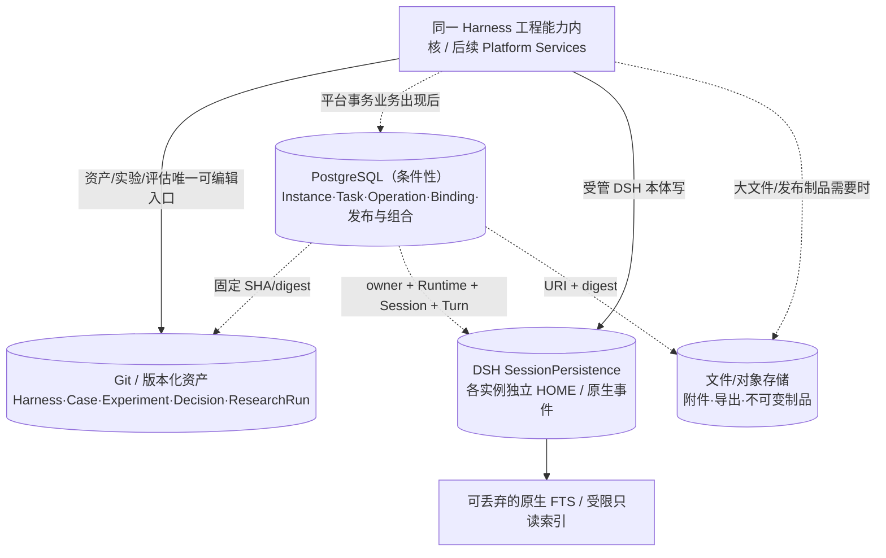

# 03｜数据分类、存储演进与关键数据契约

## 0. 当前事实与未来写权

当前 Git 仓库保存源码和研究证据。未来工具或平台可受控写入同一个 Git 事实源，也可在需求明确时迁移写权与存储；不得保留两个可编辑版本。本章定义数据合同，阶段条件统一引用 [05](05_实施路线与迭代计划.md)。

## 1. 四类存储域与第五类派生视图



| 分类 | 写入权威 | 典型物理格式 | 放什么 | 不能放什么 |
|---|---|---|---|---|
| 版本化源码和研究口径 | 当前宿主研究工作流；将来可交给平台 Asset/Evaluation Service | Git 文件、Markdown/YAML（按现有合同）、冻结 Run、Manifest/Digest | Harness/Plugin/Skill、Experiment、Candidate、Case、Decision、研究 Run、Variant 研究依据、业务组合定义源码 | 运行中的 HOME、无界 Session token 流；同内容第二份可编辑 PG 记录 |
| 平台操作/业务对象 | 真实平台服务（引入前可先用单一本地操作记录） | 结构化 PG 表、唯一键、短事务 | 实例绑定、管理任务、Operation、Session Binding/Invocation、发布状态、MCP 登记与组合来源引用 | Git Candidate 或组合定义正文、所有 DSH 原生事件的可写镜像 |
| DSH 原生会话 | 各自的 DSH SessionPersistence 写者 | 独立实例 HOME、JSONL/压缩及单写互斥（以锁定版本为准） | Meta Session、业务 Session、模型/工具事件与可读取的执行历史 | 平台审批、研究 `Decision` 的第二份权威 |
| 文件制品 | 生成制品的唯一流程 | 本地路径/对象 URI、digest | 图片、报告、大附件、备份、不可变依赖包 | 无版本约束的“当前可编辑 Harness”影子副本 |
| 派生索引/衍生采集 | 唯一构建者；默认索引可重建，Trace B 按第 6 节持久合同 | 原生 Query/FTS、受限只读索引；B 可用 PG 等持久存储 | 检索、步骤树与已选择 B 的 ACK/重放副本 | 反写原会话、第二可编辑事件权威、未核验就声称完整 |

## 2. 数据对象身份与关联模型

| 对象 | 主键/引用草案 | 唯一事实含义 | 关联注意事项 |
|---|---|---|---|
| `agent_id` | `kebab-case` 当前研究对象 | 一类业务 Agent 研究身份 | 不等于某容器或 Profile |
| `experiment_id` | `EXP-<agent-id>-NNN-r<12位随机十六进制>`（旧 ID 保留） | 一项 Harness 变更假设 | Baseline/Case/Decision 来源唯一 |
| `research_run_id` | `run-<UUIDv4>` | 一次冻结评测事实 | 保存案例快照、模型、镜像、输出/误差；不重复编辑原证据 |
| `asset_ref` + `source_digest` | `experiment:<id>` / 固定 Git ref / 可恢复 Release | 本次实际声明装载的资产 | 是否支持 `release:<id>` 以当前项目验收矩阵为准，设计不能直接证明能装载 |
| `instance_id` | 稳定平台或自用工具 ID | 某次可查回的运行实例逻辑身份 | Docker ID 会变；HOME/装载摘要须绑定 |
| `runtime_owner_key` | 不透明、稳定、不可重复使用的拥有者键 | 给 Runtime ID/Session ID 限定命名空间 | 防重建/跨实例 Session ID 撞号；按实测契约定最终字段 |
| `dsh_runtime_id` + `dsh_session_id` | 原生 DSH 标识 | 一次原生会话 | 不假定全局唯一；Meta HOME 与业务 HOME 互相隔离 |
| `invocation_id` + `turn_locator` | 平台创建/来自原生的定位引用 | 一次业务用户请求如何落到某原生 Turn | 一次 Invocation 不等于一个 LangSmith Span |
| `operation_id` + `request_key` | 平台内稳定去重键 | 某次平台修改动作/回执 | `unknown` 不可按失败盲重试 |
| `harness_version_id` | 仅发布产品发生时产生 | 真正的 published/withdrawn 平台事实 | 不是 Git commit、`Research Release` 或 `Decision adopt` |
| `deployment_id` | 仅新会话路由发生时产生 | 对新会话选版的业务启用事实 | 旧 Session 不能静默漂移 |
| `composition_version_id` | 仅真实组合 Tool 发布时产生 | 固定的组合定义、依赖与工具 Schema | 不等于 Agent HarnessVersion |

## 3. 数据实现对阶段路线的支撑（阶段条件见 05）

### R0：先保全现有唯一事实源（**不建数据库**）

- 保留 `agents/<agent>/evaluation.md` 的唯一 Case/预期，Git Experiment 的 `candidate/`、`decision.md` 和 Run 的冻结结构。
- `dsh-dev` 现有实例状态放仓库外；DSH HOME 保持实例独立；原生 Session 不回流进 Harness Git。
- 每次实验能够由固定来源、镜像摘要、输入快照、资源配置、Run 和原生 Session 引用**核查**；缺少必要字段时完善 Run 合同。
- 仅保留必要版本化文件，无消费者不创建“索引/资产登记总表”的多格式可编辑副本。

### R1：为了使用便利而建只读索引（可选）

例如 `assets.list`/`runs.find` 跨目录查找的消费者真实出现，可先从 Git/Run 目录动态扫描；真的慢了才建立一次性**可重建**索引，明确索引 schema、来源 sha、更新时间。文件目录可直接用于个人工具；是否使用 SQLite FTS 由检索需求决定。

### R2：先稳定身份、关系与恢复，再选技术

按实际用户故事记录：`AgentRef ↔ Instance ↔ LoadSnapshot ↔ DshRuntime/Session ↔ ResearchRun`。如仅 CLI 同一进程，仓库外少量状态文件就能恢复，先保留；当出现**多入口并发写、持久异步任务、需要跨浏览器重启查 Operation、关系查询繁琐**，再做数据库选型小实验。

| 选择 | 合适条件 | 当前限制 |
|---|---|---|
| Git/文件 | 当前唯一编辑者、实验/Run 是主体、短写，消费者少 | 跨对象事务/并发更新弱；不可假装多用户协调 |
| SQLite 本地（可选） | 单机单写主路径、有限并发、读索引与小型状态库 | WAL 仍单写事务，跨主机共享不可当 PG 用 |
| PostgreSQL | 多写入口、异步 Operation/Session/Deployment 真实存在，需要事务与关系查询 | 引入数据库实例、迁移/备份和运维成本；不等于每个模块必须建表 |

Git/文件满足所选恢复与查询需求时，R2 继续使用该实现，以真实恢复和查询证据验收。

### R3：把改进证据链组成统一业务关联

首条工具闭环有且只有明确写者：原始 Trace 来自 DSH，反馈来自原生反馈接口（若真实核实支持，未核实可用独立待确认问题），`Case` 在唯一 `evaluation.md`，Experiment/Run/Decision 在 Git；统一工具只是调用相应写入口与冻结引用，不能自己复制一套可编辑 Case。

### R4：真实业务消费倒推 PG（条件性）

第一次需要平台化时可增量建表，而非一次铺开全部数据域：

| 触发故事 | 候选表 | 必须说明的唯一写入事实 |
|---|---|---|
| 持久管理 Agent/实例 | `agents`, `instances` | 平台对象身份、期望状态、装载来源、最后观察 |
| GUI 与 Meta 共用副作用动作 | `operations` | operation/request_key/执行确认/unknown |
| 业务 Session 与逐轮对话 | `session_bindings`, `invocations` | 稳定关联与本次请求状态，不保存原生聊天正文 |
| 管理委托任务 | `tasks`（使用时） | 用户目标、已确认对象、计划 revision |
| 产品发布/启用 | `harness_versions`, `deployments` | published 与 enabled 的不同状态 |
| MCP Server 注册/组合发布 | `mcp_servers`, `mcp_compositions`, `mcp_composition_versions` | 注册配置、组合源码引用/摘要与发布状态；不另存可编辑定义或图 |
| 待处理问题收件箱 | `issues`（可选） | 问题处理状态与来源引用，非 Case 正文 |

每张表必须绑定实际需求消费者、写者、状态迁移及一条有效查询。研究 Run、平台操作和业务 Invocation 按各自语义建模，是否建立平台 `runs` 表由实际查询需求决定。

## 4. 数据契约示意（不是已实现接口）

### 4.1 资产装载快照

```json
{
  "agent_id": "example-agent",
  "source_ref": "experiment:EXP-example-agent-001-r0123456789ab",
  "source_digest": "sha256:<actual-content-hash>",
  "runtime_image_id": "<verified-image-id>",
  "runtime_version": "<locked-dsh-version>",
  "profile_preset_ref": "<actual-manifest-ref>",
  "dependency_manifest_ref": "<immutable-reference>",
  "home_owner_key": "<stable-instance-owner>",
  "verification": {"mount": "verified", "session_probe": "not-run"}
}
```

例子中尖括号字段都是**占位值**，其名字、API 格式和摘要算法需按实机锁定版 DSH 与仓库现有工具调整。`verified` 仅代表对应局部探针，不能推断业务成功。

### 4.2 管理操作回执

```json
{
  "operation_id": "<uuid>",
  "request_key": "<stable-client-idempotency-key>",
  "target_ref": {"type": "instance", "id": "<instance-id>", "source_digest": "<digest>"},
  "action": "restart",
  "state": "unknown",
  "observed_at": null,
  "evidence_refs": [],
  "next_action": "reconcile-before-retry"
}
```

平台自己保证 `request_key` 不重复生成管理命令记录，但不能凭此保证远端 Docker/DSH/MCP 恰好执行一次。只有状态证据充足才能从 `unknown` 变为 `succeeded/failed`。

<a id="comparison-environment"></a>
### 4.3 比较运行的外部状态合同

HOME/Session 隔离只隔离 DSH 自身。业务任务、告警、知识库、文件、缓存、时间窗口、外部服务和工具副作用仍可能污染比较。以 Case 为单位选择并核验一种方式：

| 方式 | 执行前实际核验 | 必须记录的依据 |
|---|---|---|
| 只读冻结数据集或响应样本 | 两端读取同一不可变版本，工具没有修改共享数据 | 数据版本/摘要、读取范围、工具模式、核验时间 |
| 可复位后端 | 每次执行前恢复同一初始状态，并查询确认复位成功 | 初始状态、复位步骤、核验结果、失败及残余副作用 |
| 独立 namespace/隔离后端 | 两端具有等价初始数据和各自读写范围，调用不越界 | namespace、数据版本、实际端点/范围和隔离验证；不记录凭据值 |

Run 或其实际环境证据记录所选方式、状态引用/摘要、时点与窗口、复位/隔离范围、执行顺序和未控因素；不要求为此预建新台账或数据库。仅声明“相同环境”不算已核验。拟作因果结论时，按假设需要交换 A/B 顺序、每次恢复初始状态，检查顺序效应，并结合重复样本与反例限制结论。

后端不可复位或隔离、动态输入无法冻结、执行次序会改变状态时，保留原观察并标明限制；可以进行观察比较，不能宣称差异由 Harness 引起。`run-comparison.ts` 的 `comparable` / `causal_comparable` 只检查已记录条件，不能证明未记录的外部状态受控或自动成立因果关系。变体、反馈转 Case、AI 评审或工具化入口使用同一合同。

<a id="mcp-composition-contract"></a>
### 4.4 业务组合定义与发布合同

开发者在 Git 维护一份组合定义源码，平台装载其引用并生成只读流程图。定义覆盖业务输入/输出、步骤及依赖、参数传递、成功判定和失败处理；采用的格式与执行器由 [T12](07_关键POC验收与架构决策.md#mcp-composition-poc)验证后确定。图和目录是派生视图，不能成为第二份可编辑定义；平台发布记录只保存来源与状态，不要求为首个组合引入数据库。

发布固定源码提交/摘要、输入与输出 Schema、执行器版本以及下游 OpenAPI 来源或 MCP Server/工具的身份与依赖版本。无法固定的上游行为标明限制，不把固定定义称为冻结了外部服务。发布制品可包含从该来源生成的不可变定义，但不成为另一份编辑入口；凭据值不进入定义、发布摘要或执行证据，调用复用现有凭据引用。

页面测试和 MCP 调用的回执均关联实际定义摘要或 `composition_version_id`，记录步骤身份、实际下游调用、参数传递、结果引用、耗时及失败/未执行/未知状态，展示内容排除凭据。步骤记录来自执行器的真实执行，Trace 写权遵循[第 6 节](#trace-contract)。业务行为见 [W6](04_核心业务闭环与服务接口.md#mcp-business-composition)。

## 5. 写权迁移协议：未来平台**内生** Git 资产

```text
当前唯一写入口（宿主研究工作流）
  → 固定来源与内容摘要
  → 选择未来唯一写者（优先 AssetService 写原 Git）
  → 受控暂停旧写入口
  → 内容/历史兼容验证
  → 切换新唯一入口（CLI/GUI/Meta 都调用它）
  → 旧入口只读或委托新入口
  → 删除一次性同步适配器
```

迁移是**一次性的写权交接**，不强制迁移物理 Git 数据到 PG；产品里出现“编辑 Candidate”的页面仍可以最终修改 Git 文件，但通过唯一受控 Service 检查路径、基线 digest、冲突和 diff。

<a id="trace-contract"></a>
## 6. Trace：原生读取与持久衍生的合同

[原任务清单](sources/DSH智能体运行平台开发任务清单_2026-10-09.md)的 TR02/TR03 要求平台持久 ACK、补取、去重和采集健康。原生历史可读不等于这些要求已满足。本节是 Trace A/B 路线、写权与存储例外的唯一维护位置。

- **路径 A：原生持久读取，默认先研究。** 平台保存关联引用，按需读 DSH 已持久化 Session，显示覆盖和缺失。原生读取或可重建索引不满足独立平台持久 ACK，TR02/TR03 原始完整任务仍未完成。分阶段交付记录选定范围和未覆盖要求。
- **路径 B：按选定范围持久采集。** 真实需求必须独立持久 ACK 且原生能力不足时，先验证游标、重放、flush 与缺口，再建立单向、持久、去重、补取的只读衍生副本。PG 或其他合适存储可保存该副本；ACK、覆盖率、恢复和保留以已验证采集合同为准。没有完成全量覆盖时，不能宣称原始完整任务完成。

B 保存选定范围内的只读衍生事件，原生日志仍是源事件权威，副本不反写 DSH。存储选型与采集覆盖以实际需求和验证结果为依据。原生从未持久化的瞬态 delta 不保证可补，除非锁定协议与实测证据支持。

B 需要按已选范围验证事件身份、ACK 后游标推进、补取/去重、缺页、schema 兼容、保留清理和崩溃恢复；未出现消费者或未获得证据时不引入采集实现。对应 POC/ADR 在 [07](07_关键POC验收与架构决策.md)记录验证方向，不能在那里另立写权规则。

TR04 步骤树可按需转换原生事件并保留原位置和缺口；选用 MCP 组合时，子调用记录来自组合执行器自身的新增执行事实。未选组合不需要伪造其步骤，也不能把转换视图称为完整原生 Trace。

## 7. 备份与恢复不是跨源瞬时原子事务

- Git：commit/tag/Research Release；确保指向的不可变资源及依赖真实可恢复。
- 平台业务状态：使用 PG 后按其官方工具备份事务一致快照（例如 `pg_dump`），不能宣称与所有 Session 同时原子冻结。
- DSH：按实际版本支持的 flush/read、锁约束和每个实例 HOME，生成可读取的 Session/附件副本；不要跨多个 Host 共写一个 Session 路径。
- 文件：内容摘要与路径/URI，制品不可被静默改写。
- 恢复核验：从已知 Agent/Instance/Run 找到正确 Session，重新打开历史、检查来源 digest/镜像/当前状态；在途未知保留未知；先验收，再宣布恢复成功。
- 删除/保留：删索引不删原生 Session；移除容器不删 HOME；发布版本撤回不抹研究历史；当前研究 Run 原始输入不可为了美观静默覆盖。

## 8. 迁移验收最小清单

1. 同一 Candidate 在任何时刻只有一个可编辑入口；另一个入口不能绕开冲突检查。
2. 同一原始 Case 能从历史 Run 找到当时冻结输入，不被当前 `evaluation.md` 修改。
3. 来源与实例/HOME 固定，容器重建后不误认别的 Session。
4. 平台重启后可查原 Operation/Invocation；网络失联显示 `unknown` 而非伪失败。
5. DSH Session/Trace 的每个视图有真实原生定位与覆盖标记；TR02 全量模式未验收就不宣称完成。
6. Git/PG/DSH/制品分别在隔离环境恢复过一次；跨源恢复前逐项核对引用。


## 9. 本章在现有项目中的约束级别

本章的 PostgreSQL 方案、关系对象与迁移模型均属于**有实际消费者后按需求选择的设计候选**。资产写权、比较环境和 Trace A/B 合同由本章维护；实际选择方法引用 [12](12_阶段决策与实际执行协议.md)，适用关系引用 [10](10_项目核心声明与执行边界.md)。
