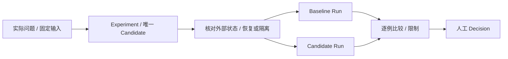

# 04｜核心业务闭环与服务接口

本章 W1–W7 是目标工作流设计；“平台管理助手当前能力”单独记录已实现接口及其边界，实际验收仍引用项目验收矩阵。阶段条件引用 [05](05_实施路线与迭代计划.md)，比较环境及 Trace 写权引用 [03](03_存储架构与数据契约.md)。方法、接口名和对象示例不表示当前实现。

## W1｜研究改进与比较

选一项有价值的实际输入或业务问题，固定 Baseline、Case、评审口径、Candidate、镜像、模型和工具来源。支持归因的失败、可能反驳它的成功观察与缺失 Case 一并保留，不用摘要补全原始证据。

两个独立 HOME 和 Session 不能隔离共享业务后端。每个 Case 的执行前状态、数据快照、复位或 namespace、执行顺序及实际核验按 [比较环境合同](03_存储架构与数据契约.md#comparison-environment)记录。不能控制外部状态时，只作带限制的观察比较，不宣称 Harness 引起了差异。代码中的 `comparable` / `causal_comparable` 仅表示已记录条件的检查结果，不替代因果论证。

修改写入正确 Experiment 的 `candidate/`，评测生成新 Run，旧 Run 不覆盖。由人将依据写入原有 `decision.md`；`adopt/continue/reject/inconclusive` 都是合法结果，不自动发布。

### 后续研究工作台与价值验证

后续研究工作台仍服务当前研究者。选择一个已有 Agent 和一项有原始证据的问题，将以下操作接成一条路径：

1. 明确选择 Agent、Experiment 和 Run，显示精确来源、Git 提交及 dirty 状态、实际装载记录。
2. 按场景查看完整 Case：当前 `evaluation.md` 定义、该 Run 冻结的输入和预期、实际输出、原始证据及已有归因分别标明来源。证据缺失时显示缺失，不用摘要补全。
3. 同时查看支持归因的失败、可能反驳它的成功观察与未覆盖 Case；执行是否完成、评判是否通过分别显示。
4. 在明确的 Experiment `candidate/` 中修改与问题相关的资产，复用现有评测入口运行所选 Case，生成新的 Run 并比较来源、观察、回归和限制；不覆盖历史 Run，不静默改变比较口径。
5. 由人将 `adopt`、`continue`、`reject` 或 `inconclusive` 及依据写入原有 `decision.md`。管理智能体可以帮助解释证据和准备修改，不能把推断写成事实、替人改评判标准或把研究判断当成业务发布许可。

计划中的 Agent 中心工作台将连接这条维护路径；当前只读首页仅提供资产清单和来源。需要真实业务任务入口时，再扩展任务视图。确定性选择、查看、执行与记录不依赖自然语言入口。界面读取现有 `evaluation.md`、Experiment、Run 和 Decision，不建立第二套可编辑 Case 库或建议库。

用一项真实研究任务验证：选择未串错来源，候选改动进入正确工作树，新运行确实装载该内容，失败和缺失如实呈现，并比原操作减少实际步骤或来源错误。首条路径证明价值后，再按复用需求用第二个 Agent 或另一种 Variant 检验；若只是给现有 CLI 增加维护成本，就停止扩展工具。

## W2｜多算力变体（仅选定时）

只有资源或组件变化是当前研究假设时才建立独立 Candidate，事前说明任务质量下限、关键退化红线、资源预算及工具背后的模型调用边界。除冻结 Case 和评审器外，同样执行 `03` 的外部状态合同。CPU、内存、token、延迟和缺测分别记录；no-compute 未证实无远程模型调用时保持未知。

研究可以引用固定 Git Baseline；完整产品变体需要真实已发布、可恢复的父版本。两者不能互相代替，任务依赖见 [08](08_112项任务追溯矩阵.md)。

## W3｜实例装载与实际运行

明确 Agent、Experiment/固定来源、镜像、HOME 和读写卷，先检查来源解析，再在新实例或新 Session 核验实际装载和用户可见行为。研究实例启动不等于长期业务服务已经接管。实际健康、来源和工具目录来自运行观察并标时间，期望配置单独显示。

## W4｜失败或反馈到 Case，再到改进

从原 Run/Session/Trace 的精确引用提出问题和 Case 建议，先人工核实；原生 feedback 接口未实测支持时不预设版本更新、撤销或并发语义。确认后只编辑 Agent 原有唯一 `evaluation.md`，再建立 Experiment、执行新比较并写 Decision。提案不能自行修改标准答案或覆盖旧口径。

工具展示原问题、提案、已确认 Case、实际 Run、反例、回归与限制；有效 Baseline 存在时展示两端对照，无 Baseline 时保留缺口。比较仍遵循 `03`，证据链完整不自动构成因果证明。没有真实收益时保留手动路径。

## W5｜管理动作与可选 Meta-Harness

先用确定性选择、查看、执行与记录验证工具价值。只有自然语言管理有实际收益才引入 Meta；管理 HOME/Profile 与业务实例分开。Meta 解释证据并准备计划，修改经同一服务完成，不能直接覆盖任意文件或操作 Docker/SQL。

修改动作按需要形成目标与来源摘要、影响预览、有效确认、真实回执和状态查询。`accepted`、执行中、完成、失败、超时与 `unknown` 各有语义；远端副作用结果未知时先对账，不凭 request_key 保证恰好执行一次。

MG06 的 R4c 覆盖只能是目标澄清或已有资产操作，完整新建/导入依赖 AG06/AG07。MG08 的 R4c 覆盖只能是已可用能力的选择与验证，四类 Hub 的完整组合、发布和绑定依赖 R5 能力。未启用 MCP Composer 不阻断普通研究或管理切片，也不能声称 MG08 全部完成，详见 `08`。

## 平台管理助手当前能力

平台管理助手的 Harness 由平台系统提示、`platform/skills/` 中的管理技能、已启用扩展的业务技能、`platform_agents`、`platform_instances`、`platform_mcp`、`platform_task` 及原生 Session 任务上下文共同构成。系统提示固定身份、可信定位、任务路由、确认边界与共同表达原则；具体流程只在对应 Skill 维护。它与被管理业务 Agent 的 Harness 分开，不会因读取 Candidate 的 AGENTS.md 或业务轨迹而切换身份。

程序根由 `HARNESS_PROGRAM_ROOT` 定位，用户工作区由 `HARNESS_ASSET_ROOT` 和 `workspace.json` 定位；当前目录不决定资产归属。新管理 Session 记录工作区 ID，旧 Session 经明确的 legacyRoots 映射恢复，原始事件与 cwd 不改写。页面只更新最新上下文；按钮发起的目标 Agent、Experiment 或 Run 写入固定任务上下文，页面切换不改变本次目标。已确认创建新版本后，后续编辑对象使用服务返回的目标 ID。

| 用户任务与入口 | 固定任务与 Skill | 已实现工具路径 | 保存及结果核对 |
|---|---|---|---|
| 从任务需求构建并交付可用智能体 | 目标、固定来源、业务 Case、复用与预算；`task-builder` | platform_task preview/start → 领域创建/装配/评测/实例操作 → begin-repair/checkpoint/rollback → deliver | 原生确认整体方案；同一目标内限额执行，真实交付检查通过后展示实例及产物。数据与恢复约束见[任务合同](03_存储架构与数据契约.md#task-delivery-contract) |
| 智能体概览“请 AI 整理特性” | Agent、Experiment、`workflow=features`；`agent-maintenance` | detail、features/read-source、edit/read、assets/diff、runs/index/show/report → features/preview | 原生确认卡保存至该 Experiment change.yaml；detail 回读。实现描述与实际效果证据分开，缺证据不补造 |
| Run 详情“请 AI 抽取决策样本” | Agent、Experiment、Run；`decision-sample-extraction` | datasets/source 分页 → datasets/preview | 确认后 datasets/apply 保存独立候选；全部 suggested，人员完成时点和标签复核后才可训练导出 |
| 管理对话配置 API/MCP 与组合工具 | 当前连接、组合及版本；`mcp-composition`，按已启用扩展补充业务 Skill | configuration/sources/*/test → saveConfiguration；list → saveCompositionDraft → dryRunComposition → publishComposition → callPublishedComposition | 原生连接设置与数据根组合目录分别唯一维护；调用提案固定版本，组合结果和扩展 compositionRun/compositionArtifact 回读；dry 无上游业务效果 |
| 日常智能体实例排障、启停 | 实例名、来源；`agent-maintenance` | instances list/detail/logs/url → preview/batch-preview → run/batch | 生命周期执行须确认；逐项回读，保留失败和 unknown；状态不替代实际 Session 与业务验证 |
| 新建智能体、编辑资产与评测用例 | Agent、Experiment、文件摘要、Case；`agent-maintenance` | new；edit/read → edit/preview → edit/apply；cases/read/update，create-context/from-run/create-preview/create | 写入确认后回读；保持唯一 evaluation.md。创建不自动启动，更新标准不能用失败输出替代需求 |
| 单父版改进与评测比较 | 固定父版、研究问题、约定 Case；`agent-maintenance` | detail.derivation → assets/read-fixed → create → Candidate 编辑 → eval/preview/start/status → runs/show/compare → decision/update | 新 Experiment 与新 Run；保存 Decision 须确认，比较说明环境差异和证据缺口，不自动发布 |
| 不同算力变体研究与“请 AI 策划算力变体 / 请 AI 分析算力变体”入口 | 固定 Agent、Experiment、父版、共同 Case、质量红线与资源预算；`compute-variant-research` | compute-variants/context → preview → create；Candidate 编辑及计划冻结后 eval → compute-variants/compare | 创建提案预览实际目标与策略并冻结摘要，确认后仍为探索性计划；模型变更约定不自动改路由。终端结论只由用户在变体界面复核确认，助手不能提交 human_confirmed；比较限定所选 Run 和已采集指标 |
| 多来源融合与继续融合 | 固定父版、各来源取舍及验证方案；`agent-maintenance` + 已发现的 harness-experiment-fusion | fusion/preview → assets/read-fixed → confirm → status → Candidate 编辑/约定评测 → verify → finalize | 同一 Session 仅自动继续已确认目标和 Case。build、load、capability 由实际命令或封存 Run 验证；口径变化、其他对象或扩大范围重新确认 |

管理助手通过工具枚举看到实际动作。后端已有的单父版派生 `create`、用例更新 `cases/update`、扩展结果读取和业务模板创建已接入助手；新增写动作沿用原生提案确认。确认结算后的工具结果只返回实际状态与回执；历史待确认预览保留在 Session 和界面，不再作为模型的当前结果。普通资产写入、Decision 写入和评测启动在提案前调用实际 preview；preview 失败不形成可执行提案。已确认融合的评测权限按真实 `source` 和约定 Case 判断，不能用额外 experiment_id 混淆目标。算力变体创建复用服务端 preview 并携带 expected_preview_sha256，确认前策略、所选 Case 或父版变化会拒绝；context/preview/compare 为只读，人工 confirm 不暴露给助手。固定来源通过 assets/read-fixed 读取 Candidate 内文件，核对 Agent、完整提交与来源摘要；排除凭据路径，二进制、超限或截断内容明确标记，不生成可编辑副本。

当前专用轨迹抽取仍只允许 `skill` 与限定 Run 的 `platform_agents` 取数/预览，不能调用实例、MCP、shell、子智能体或人员复核动作。通用维护流程不能解除该限制。特性整理专用会话同样只开放 agent-maintenance 和 platform_agents 的业务读取、特性预览；服务端固定 Experiment，用户确认前不写清单。features/read-source 提供同一 Agent 的研究说明、观察和 Decision；历史 Experiment 相对引用按所属版本解析，新保存统一使用数据根相对引用。当前版本派生读取 detail.derivation 的可恢复父引用，未提交版本或 Candidate 与固定提交不一致时返回明确缺口，不能用 baseline_ref 或历史 parent_ref 替代。

算力变体专用会话只读取 `compute-variant-research`，工具限于 `platform_agents`、`platform_task` 和技能读取；原生作用域同时约束可见工具和实际执行。只读策划继续先以少量代表轨迹形成预览；生成执行通过固定目标的代码变体任务办理，不开放 shell、平台源码调试或其他管理技能。普通管理会话和决策样本的限定 Run 约束分别保持原语义。

`compute-variants/build-preview/build` 使用固定入口、当前 Candidate 摘要和真实构建预览摘要；`freeze-preview/freeze` 返回并核对完整 `freeze_input`，确认卡展示真实 Git 差异，不以整体任务授权代替本次提交确认。`tasks/capabilities` 可限定 `server_id` 读取实际发现的工具 schema，组合绑定来自当前目录，缺失契约不靠名称推导。`context` 按实际文件、构建回执和 Run 返回生成、构建、冻结及装载状态；用户流程见 [06](06_界面与前后端渐进建设.md#36-不同算力需求的近似等效变体)，持久数据合同见 [03](03_存储架构与数据契约.md#当前代码变体与固定外部输入)。

当前接口支持文本读改、来源派生、即时评测及证据查询，尚不覆盖任意资产二进制编辑、删除/重命名、自动 Git 提交推送、Research Release 创建或长期自主调度。普通未确认预览仍依赖当前平台进程；评测执行关联可在重启后回读，受控任务须核对回执并显式恢复，不能承诺自动重试或续跑。固定来源不可恢复、外部模型或业务服务不可用时，报告具体阻塞及仍可完成的读取，不宣称业务通过。

### 任务交付入口

管理对话通过 `task-builder` Skill 将用户目标与已有资产、工具和测试整理为一份方案。先查已有信息，仅对关键缺口集中询问；`platform_task preview` 校验范围，`start` 进入原生确认卡。已有目标必须来源可核对；改进已启用版本时从固定父版派生，使用真实回执绑定新 Candidate，不切换或覆盖原启用版本。创建角色和身份测试只表示资产已建立，业务测试与工具能力仍须单独验证。

能力查询与装配复用 `platform_agents` 的 `tasks/capabilities`、`tasks/assembly-preview`、`tasks/assembly-apply`。已知 Agent 或来源时限定查询范围；结果分别说明已发现资产、已配置工具及待运行验证的绑定。装配批量核对源文件、目标摘要与配置引用后写入，不执行被复制脚本。MCP/API 连接继续使用原生 MCP 配置管理。评测沿用 `eval/preview/start/status/cancel`；需要业务报告时明确传入 `artifact_export`，从真实业务输出导出，不把评测报告充当业务产物。

`platform_task` 的 `begin-repair` 在修改前预留修复轮，`checkpoint` 查实际回执，`rollback` 恢复可核验的固定内容。页面通过 `assistant/task/status` 及任务卡的 `pause/resume/cancel` 查询和控制同一原生 Session，暂停信号直接送达活动操作。`deliver` 固定方案中的来源、Case、设备范围与业务工具要求，由后端执行检查及代表业务探针；活动任务不能通过领域交付入口绕开范围和预算。通过后交付卡提供实际智能体入口及 Run 业务产物下载；失败保留证据与具体缺口。预算、持久化、fork 和恢复的完整约束只在 [03 任务合同](03_存储架构与数据契约.md#task-delivery-contract)维护，源码与接口可达不代表真实构建或业务效果已经验收。

确定性回归位于 `platform/plugin/test/assistant.test.mjs`、`agents-client.test.mjs`、`evaluation-client.test.mjs`、`extraction-scope.test.mjs` 和 `independent-workspace.test.mjs`，分别验证动作可达与确认、按钮固定目标、抽取限制及外置工作区读改回读。真实模型是否正确选 Skill、读取证据、提交有效提案及解释失败，需要部署环境中的管理对话验收；这些测试不能代替模型效果证明。

### 面向用户的反馈

表达原则唯一维护在 [user-facing-output.md](../../platform/prompts/user-facing-output.md)，从可信程序根装载到所有平台管理会话的系统提示，覆盖进展、确认说明、完成与失败反馈。各业务 Skill 规定取数和核验方法，不再要求把内部检查逐项搬到聊天里；完整工具回执和已有详情保留。普通原生会话不自动注入这份提示。是否保存、是否完成、待人工复核及影响判断的限制始终向用户说明。

设计参考 [Canada.ca 内容指南](https://design.canada.ca/style-guide/)的任务导向与重要信息前置、[GOV.UK 完成反馈](https://design-system.service.gov.uk/patterns/confirmation-pages/)的结果和后续动作，以及 [Nielsen 的渐进披露](https://www.nngroup.com/articles/progressive-disclosure/)；具体采用方式见上述原则。这些资料是设计依据，不是本平台用户效果的实验证明。[Poynter 介绍的华尔街日报专题写法](https://www.poynter.org/archive/2003/the-nut-graf-part-i/)常先用场景引入，再说明主题意义；这里借鉴解释意义的思路，不让操作反馈等待叙事铺垫后才交代结果。

这些要求足够简短，无需新增写作 Skill 或评分器。其他业务智能体可以在自身 Harness 演进中引入同一来源的固定版本，并用领域任务验证；只有运行时实际装载才生效。独立部署需要携带文本时，应从固定程序提交生成只读资产并保留来源引用，不另行手工维护一份规则。本轮只调整平台管理助手，没有自动改动业务智能体的表达或证据标准。

## W6｜Hub、MCP 与组合工具

目录显示本次实际可用的 MCP、Skill、Plugin、知识源的来源、依赖和作用对象。目录发现、配置保存、实际装载、调用成功和评测通过分别验证；不自动执行未知插件，不预建商店和通用安装通道。

MCP 按锁定实现验证初始化、initialized 通知、工具/资源发现、受控调用及服务返回的 Session 标识；工具发现不是业务调用成功。单调用与组合的实施顺序见 [05](05_实施路线与迭代计划.md#mcp-composition-route)。

知识保留原文版本与位置；运行事实来自确定性查询并带观察时间；研究材料引用原 Run。生成报告关联输入和证据，不自动升级为已核验知识。

### 业务组合 MCP 工具

当多个细粒度接口共同完成一个业务步骤或子任务时，将它们组合成一个业务 MCP Tool。例如输入资产名称和时间范围，先查询资产，再用返回的资产 ID 查询告警，最后返回该资产的告警结果及证据引用。LLM 选择并调用这一个工具，执行器确定性地完成内部步骤，不在每一步再次调用模型。工具分组缩小候选工具范围，业务组合减少模型反复选工具和传参数；实际准确率与效率收益须由 [T12](07_关键POC验收与架构决策.md#mcp-composition-poc)比较验证。

原子步骤可以来自 OpenAPI 接口或已接入的 MCP 工具。复用现有 OpenAPI 调用、MCP 注册/客户端、凭据配置和登录凭据缓存，不另建连接或授权清单。开发者维护业务输入/输出、步骤依赖、参数映射和成功/失败判定，平台负责装载、验证、测试与发布；唯一源码和版本合同见 [03](03_存储架构与数据契约.md#mcp-composition-contract)。

首版提供只读流程图、输入表单、测试按钮和业务结果，允许展开实际步骤详情，界面交互见 [06](06_界面与前后端渐进建设.md#mcp-composition-ui)。首版不提供用户手动编排；这只是当前范围，未来有真实需求时再评估编辑功能，不预建拖拽编辑器或通用 DAG 引擎。图由定义生成，页面测试与实际 MCP `tools/call` 共用同一个执行入口。

组合返回有明确范围的业务结果和必要证据引用，避免将全部原始接口响应堆入模型上下文。前置步骤失败时停止依赖它的步骤，区分失败、未执行与结果未知；写操作超时且无法确认结果时先对账，不盲目重跑整个组合。执行器保留真实子调用和耗时，发布后的工具需由隔离 DSH 实际发现并调用。组合 Tool 发布不等于 Agent HarnessVersion 发布。

## W7｜业务版本发布、启用与回退（有长期业务需求时）

`HarnessVersion` 固定 Git 来源、资产摘要、标准 Runtime 镜像、Profile、能力与依赖版本、模型配置引用和非秘密运行配置；发布后不可变且可恢复。发布决定与 Research Decision 分开，由被授权操作者明确确认，记录身份、依据、摘要和时间。关键行为失败或证据不足时不发布。

`Deployment` 记录期望版本、回退目标与启用决定；`Instance` 显示容器和 DSH 的实际来源、状态及观察时间。统一入口的路由要用真实 Session 和业务结果核验，不能由容器健康推断。

采用所有新 Session 直接切换到已启用版本的规则，不设置灰度权重；已有 Session 继续绑定旧版本和实例。回退只改变后续新 Session 的路由，不能撤销既有输出、外部写入或承诺无损迁移在途 Session。旧实例保留到关联 Session 结束，且活跃 Schedule 停止或迁移已验证；无法恢复的会话明确失败。撤回版本不删除旧证据和引用。

## 多用户数据边界与选型门槛

当前平台面向个人开发者，未实现多用户授权或隔离。[EXP-007](https://github.com/wr5912/harness-engineering-platform-data/blob/9afc8fd0047367deb9df5b51595f101835359044/evolution/experiments/EXP-security-operations-expert-007/decision.md)的自动化试验只提供任务创建、查看、删除范围的证据；[门户 iframe 联调](https://github.com/wr5912/harness-engineering-platform-data/blob/12b6f552d4c15a475d9443c7029276810aafdbf4/agents/security-operations-expert/docs/门户联调记录.md)是单操作者试点，不证明 SSO 或 Session/Schedule 用户隔离。

既有 JSON 后端实例中，`DSH_HOME=/var/lib/dsh` 的任务目录为 `storages/schedule.json`，会话为 `sessions/`；这些是已记录的实例布局，使用前核对实际锁定版本和配置。Host 共享 Schedule 目录及原 Session 绑定，不等于平台用户归属。独立文件、Agent 容器和浏览器 owner 认证都不能证明同一 Host 内用户隔离。

若选择共享 Host，Session、Schedule 和执行历史使用同一个经服务端确认的用户身份与对象归属。逐一验证列表、读取、继续、取消、消息、附件、导出、任务 CRUD、历史、模型工具及后台定时投递的入口；不能只信调用方 Session ID、浏览器 Token 或前端过滤。归属隔离完成前，Host 级任务 catalog 不直接开放给多个用户。

开放前用两个用户在同一 Agent 下分别建立 Session 和任务，从 UI 与 Remote 交叉读、改、删和查看历史，检查模型工具、到期投递目标及重启后的归属。共享 Host 无法覆盖这些入口时，改为按用户隔离 Host/HOME，并由 Gateway 校验身份和路由。单人工具不因此预建 RBAC、租户或审批平台。

## 服务接口与交付切片

| 逻辑接口示例 | 唯一责任 | 交付条件 |
|---|---|---|
| `assets.inspect/diff`, `experiments.prepare` | 定位并编辑 Git 的唯一资产来源 | 保留现有 CLI 和 Experiment 语义 |
| `evaluation.run/compare` | 新 Run、冻结口径、实际环境和限制 | 不覆盖历史，遵循 `03` |
| `instances.inspect/probe` | 实际来源与最近观察 | 区分配置、容器与业务结果 |
| `operations.preview/confirm/get` | 已确认动作与真实回执对账 | 修改范围明确，unknown 可恢复 |
| `sessions.bind/invoke/history` | 稳定请求与原生 Session 的关联 | 真实会话和身份验证后引入 |
| `hub.inspect/test`, `mcp.inspect/validate/test/publish` | 实际目录、开发者组合定义、共用执行入口与组合版本 | 部分目录操作不能替代完整 MG08 |
| `versions.publish`, `deployments.enable/rollback` | 不可变版本与后续会话路由 | 独立发布依据及操作者授权 |

这些接口仅示意责任，实际消费者出现前不建立空实现。最先交付一条研究路径；是否选择变体、Meta、MCP、发布或多人故事，由 [05](05_实施路线与迭代计划.md)的条件和实际需求决定。
