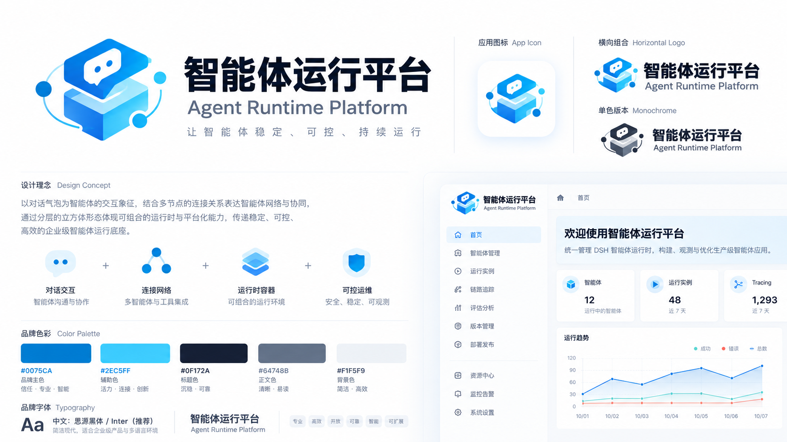
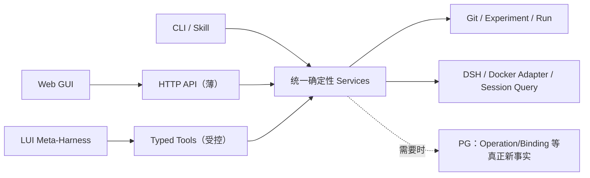

# 06｜界面信息架构与前后端渐进建设

> 视觉参考：附件 ZIP 的 `01`～`11` 张 PNG，以及补充的 Logo 与图标图片。本文说明界面所依赖的业务能力；视觉方向为白底、蓝线、留白和按需展开功能。

阶段与进入条件只在 [05](05_实施路线与迭代计划.md)维护。图片中的 KPI、成功状态和操作结果均为草图，不能作为真实测量或运行证据。

## 1. 界面与技术实现不是同一个开发阶段

**远期目标体验**：首屏无强制展开侧栏，LUI 是管理任务的第一入口。用户自然语言提出“查这个 Agent 为什么答错”“给它加 MCP”“基于已发布版做低算力变体”“重启实例”。Meta-Harness 可理解与解释；但涉及写入资产、发布、Docker、用户数据等操作，只能通过和 GUI 按钮相同的确定性服务预览、确认和执行。

**近期实现路线**：CLI/Skill → 必需的工具详情/薄 Web → 若真正有跨入口操作，抽一个后端 Service → 面向明确任务的 GUI → 有收益证据后增加 LUI/Meta-Harness。不要为了首屏的美观先做无消费者的计数缓存、任务流水、第二事件库。

## 2. 11 张草图的可实施映射

| 原 ZIP 图片 | 页面定位 | 最早可靠业务能力 | 前后端真实数据来源 | 建议落地顺序 |
|---|---|---|---|---|
| [01_智能体运行平台首页 dashboard.png](<imgs/01_智能体运行平台首页 dashboard.png>) | AI 原生 LUI 首页、近期任务、极简首屏 | R3 具备一条可委托的可用工具链 + R4 受控操作回执 | Service/Run/Operation 当前事实；Meta 独立 Session | R4c；不在 R0 建首屏 |
| [02_智能体管理.png](<imgs/02_智能体管理.png>) | Agent/Harness 来源、候选、实例、版本/差异 | R0 来源解析 + R1 inspect/diff | Git + 外部实例状态/后期 PG | R4b 首选 |
| [03_管理对话.png](<imgs/03_管理对话.png>) | 目标绑定、预览、确认、真实回执 | R4a Typed Service/Operation | 管理 DSH Session + Operation 事实 | R4c；不能早于 Service |
| [04_能力hub.png](<imgs/04_能力hub.png>) | 业务组合只读流程、输入测试与结果 | R5 固定两步 POC + Gateway | 开发者定义引用、真实 MCP tools/list/call 与执行回执 | 按 [05](05_实施路线与迭代计划.md#mcp-composition-route) |
| [05_能力hub.png](<imgs/05_能力hub.png>) | MCP Server 目录、工具发现/调用 | R5 MCP01/02 实机验证 | Server 配置 + 真实握手/观察时间 | R5 先于组合展示 |
| [06_算力变体.png](<imgs/06_算力变体.png>) | 已发布父版、候选、资源预算与等效比较 | R0 一对一比较；产品谱系须有真正 published HarnessVersion | Git Run/Case/Decision；后期 Version/Deployment | R4b 可先做只读研究对比；产品完整版本页 R5 |
| [07_DSH实例.png](<imgs/07_DSH实例.png>) | 实例列表、装载、健康、容器生命周期 | R1 dsh-dev inspect/probe，后期业务实例 | Docker 实态 + DSH 探针 + 稳定实例绑定 | R4b 首选 |
| [08_智能体对话.png](<imgs/08_智能体对话.png>) | 业务多轮会话与历史 | R4d 长期业务 Session/Binding | DSH 原生会话；必要的 Invocation 关联 | 按真实业务会话需求 |
| [09_反馈评估迭代.png](<imgs/09_反馈评估迭代.png>) | 反馈问题/测试集/评测/运行比较 | R3 反馈（或 Run）→ Case → Eval | DSH feedback/Trace、Git Case/Run/Decision | R4b 优先做基于 Run 的改进链 |
| [10_版本发布.png](<imgs/10_版本发布.png>) | 不可变发布、谱系、业务启用 | R5 真正发布/长期业务路由 | 可恢复源内容 + `harness_versions` + `deployments` | R5 产品发布后 |
| [11_设置与运维.png](<imgs/11_设置与运维.png>) | 运行配置、备份/恢复、失败和容量 | R2 来源/HOME/备份合同 + 后期持续运营 | Git/PG/DSH/文件各源观察 | R4b 可做极简诊断；完整运维延后 |

落地顺序依据业务前置能力安排；早期 GUI 可将多项业务入口合并到同一页面，路由与服务按实际交互需求划分。

### 2.1 Logo 与相关图标参考

原图中的“智能体运行平台（Agent Runtime Platform）”名称有误。应用 Logo、横向组合、单色版本及界面示例中的名称，使用时须统一改为[根级 AGENTS.md](../../AGENTS.md)中的“Harness工程平台（Harness Engineering Platform）”。原图按原字节保留，图形、配色和图标仅作视觉参考。

## 3. 前端概要设计（按任务切面，不按所有页面切面）

### 3.1 R4b 的候选视图：按选定故事取用

| 视图 | 用户最重要的一个动作 | 数据消费者 | 空态/失败态 |
|---|---|---|---|
| A. Asset Inspector | 定位 Agent，查看唯一 Candidate / Baseline 的固定来源和 diff | `AssetResolver + Git` | 缺 Agent/dirty 来源与读取失败可区分 |
| B. Experiment / Run Compare | 选定两个 Run，查看同 Case 的质量和成本/限制 | `EvaluationReader + Git Run` | 不可比、缺资源数据、评测失败真实显示 |
| C. Instance Inspector | 看到实例真实容器/镜像/装载/home/业务探针，必要时执行明确受控动作 | `InstanceAdapter + OperationService(若已有)` | Docker running ≠ DSH 业务可用；最近观察过期 |
| D. Evidence & Improvement | 从 Run/Session/Trace 定位失败→提案→人工确认 Case | `EvidenceReader + Case Proposal` | 原生事件不可读、Session 已丢失、提案尚未确认 |

这些视图可以是同一应用的 tab，首个故事只选必要视图，不要求同时实现四个。**先从最薄“证据→改进”竖切片实现**，不必做复杂导航、消息通知、组织设置或可定制工作台。

### 3.2 R4c 的 LUI 首屏（长期体验约束）

布局：中部为明确的自然语言输入 + 精确目标 chips；下方仅真实最近任务/可继续会话/Agent 入口；无默认展开侧栏。首屏“成功”不是生成一个聊天回答，而是从一句话得到**一张可核对的真实 Operation/ResearchRun 卡**。普通只读查询不强制确认；修改型动作必须按目标/source_digest/影响范围出 preview，用户确认后执行。

不同状态：`澄清目标 → 只读查询/计划预览 → 待确认 → accepted → executing/unknown → succeeded/failed → 证据深链`。页面不得把“AI 建议已修改”写成“资产已变更”，也不能把“容器 healthy”写成“任务完成”。

MG06/MG08 在 R4c 只能交付已可用能力的局部操作，完整新建/导入或四类 Hub 组合依赖 [08](08_112项任务追溯矩阵.md) 的 R5 前置项。没有选择 Meta 或 MCP 的切片不执行相应界面验收。Run 比较须展示 `03` 的外部状态和因果限制。

### 3.3 后续增强

MCP Hub 按 [05 的组合路线](05_实施路线与迭代计划.md#mcp-composition-route)提供目录、调用与组合展示；算力变体先只读研究对比，只有真正发布版存在才开放“从已发布父版派生”；反馈页面只有原生接口可用且真实来源定位才允许提交；运维统计没有数据就显示空态，不以草图数值填充。

### 3.4 业务组合详情与测试

选择已装载的组合及版本，查看业务用途、输入要求和由定义生成的只读流程图。图显示步骤名称、依赖与本次执行状态；首版不提供新增节点、连线或编辑调用逻辑。业务范围引用 [W6](04_核心业务闭环与服务接口.md#mcp-business-composition)，定义来源引用 [03](03_存储架构与数据契约.md#mcp-composition-contract)。

输入表单依据组合工具的输入 Schema 生成，点击“测试”后走实际 MCP 调用所用的执行入口，返回有明确范围的业务结果、证据引用和耗时。展开步骤可查看实际参数传递、下游结果及失败位置，展示内容排除凭据；首屏不堆叠原始响应或底层配置。

缺少定义、尚未测试、执行失败、依赖步骤未执行和写操作结果未知分别显示。打开详情或刷新页面只读取定义与已有回执，不触发调用。测试和发布后调用的一致性由 UI-04 验证，手动编辑的后续取舍遵循 [05](05_实施路线与迭代计划.md#mcp-composition-route)。

## 4. 后端概要设计：一个服务内核，多种入口适配

API 既要可供页面加载数据，也必须能够对动作返回**精确身份**：`target_ref`、`source_digest`、`operation_id`、`research_run_id`、`session_binding_id`、`dsh_runtime_id/session_id`、`observed_at`、`evidence_refs`。一次页面刷新应通过同一个稳定 ID 找回旧操作，而不是再次触发动作。

**反面设计**：`POST /api/chat-command` 将自然语言传给有 Docker Socket 的 Meta，让它直接随意改文件或发布；GUI 另走一套 SQL。这会形成两个行为不一致的事实源，应禁止。

## 5. 查询与交互契约（示意）

| 目标体验 | 最少查询/动作 | 数据保存/权威 | 何种假象不得出现 |
|---|---|---|---|
| Asset 卡片 | `assets.list/describe/diff` | Git 唯一 Candidate，后期 PG 仅登记/引用 | dirty ≠ published |
| Agent 实例卡 | `instances.describe/probe` | 状态索引 + Docker/DSH 当前观察 | running ≠ available |
| 管理确认卡 | `operations.preview/confirm/get` | 后期 PG operation；受控写服务修改 Git/Docker | HTTP accepted ≠ succeeded |
| 研究 Run 比较 | `researchRuns.get/compare` | Experiment Run 冻结事实 | 当前 Case 变化不能重写历史评分 |
| Trace 树 | `trace.readNative/transform` | 按 [03](03_存储架构与数据契约.md#trace-contract) 选择原生 A 或持久衍生 B；标覆盖/版本 | 实时片段 ≠ 持久、完整轨迹 |
| 发布版详情 | `versions.inspect/publish` | 不可变资产+真正发布业务记录 | Research Release ≠ published |
| 业务对话 | `sessions.bind/invoke/history` | 绑定关系 + 原生 DSH Session | 旧会话被默认新版偷换 |
| Hub 组合工具 | `mcp.inspect/validate/test/publish` | 开发者定义引用 + 派生只读图 + 不可变发布版及实际回执 | 流程可展示或页面测试成功不能替代外部 DSH 调用 |

## 6. 真实界面验收切面

**UI-01 Asset↔Eval**：从 Agent 列表准确打开 fixed source → diff → 启动真实 eval → 回到逐例结果；刷新后 Run/来源可找回。

**UI-02 Instance↔Evidence**：选一个实例，看到精确 HOME/镜像来源，发真实业务探针→ Session ID→ Trace；停止容器后历史不被 UI 假装清零。

**UI-03 Meta↔GUI 一致性（仅启用 Meta 时）**：管理对话说“重启这个实例”，GUI 按钮和 typed tool 走同一 preview/operation；陈旧预览被拒绝；超时 `unknown` 不盲发第二次。

**UI-04 MCP Gateway（R5）**：开发者定义的两步组合生成只读流程，输入表单测试与实际 MCP `tools/call` 共用执行入口，结果和实际步骤可下钻；发布后由新的隔离 DSH 实例发现并成功调用。真实失败、未执行和未知状态可见；首版验收不要求手动编辑。

**UI-05 Variant/发布（R5）**：只能从同 Agent 可恢复 published 父版本派生；独立 Candidate/Run；新 Session 路由修改不影响旧 Session。

## 7. 样式建议与工程可复用性

保留草图的白底、蓝色 #0075CA、留白、细线圆角、证据展开抽屉与轻导航；主焦点是管理意图，文件来源、Trace 和配置按需展开。组件按实际消费者拆分，复用 `EvidenceLink`、`SourceDigest`、`ObservedAt`、`OperationReceipt`、`UnknownState` 等小型展示元素。
