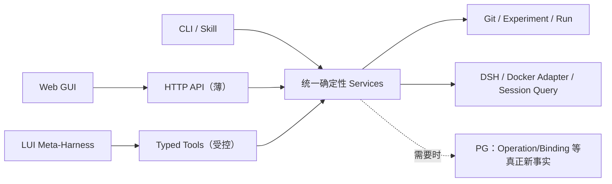

# 06｜界面信息架构与前后端渐进建设

> 视觉参考：附件 ZIP 的 `01`～`11` 张 PNG，以及补充的 Logo 与图标图片。本文说明界面所依赖的业务能力；视觉方向为白底、蓝线、留白和按需展开功能。

阶段与进入条件只在 [05](05_实施路线与迭代计划.md)维护。图片中的 KPI、成功状态和操作结果均为草图，不能作为真实测量或运行证据。

## 1. 界面与技术实现不是同一个开发阶段

**远期目标体验**：首屏无强制展开侧栏，LUI 是管理任务的第一入口。用户自然语言提出“查这个 Agent 为什么答错”“给它加 MCP”“基于已发布版做低算力变体”“重启实例”。Meta-Harness 可理解与解释；但涉及写入资产、发布、Docker、用户数据等操作，只能通过和 GUI 按钮相同的确定性服务预览、确认和执行。

**近期实现路线**：CLI/Skill → 必需的工具详情/薄 Web → 若真正有跨入口操作，抽一个后端 Service → 面向明确任务的 GUI → 有收益证据后增加 LUI/Meta-Harness。不要为了首屏的美观先做无消费者的计数缓存、任务流水、第二事件库。

## 2. 11 张草图的可实施映射

| 图片（本地术语修订版） | 页面定位 | 最早可靠业务能力 | 前后端真实数据来源 | 建议落地顺序 |
|---|---|---|---|---|
| [01_智能体运行平台首页 dashboard.png](<imgs/01_智能体运行平台首页 dashboard.png>) | AI 原生 LUI 首页、近期任务、极简首屏 | R3 具备一条可委托的可用工具链 + R4 受控操作回执 | Service/Run/Operation 当前事实；Meta 独立 Session | R4c；不在 R0 建首屏 |
| [02_智能体管理.png](<imgs/02_智能体管理.png>) | Agent/Harness 来源、候选、实例、版本/差异 | R0 来源解析 + R1 inspect/diff | Git + 外部实例状态/后期 PG | R4b 首选 |
| [03_管理对话.png](<imgs/03_管理对话.png>) | 目标绑定、预览、确认、真实回执 | R4a Typed Service/Operation | 管理 DSH Session + Operation 事实 | R4c；不能早于 Service |
| [04｜能力 Hub](<imgs/04_能力hub.png>) | 业务组合只读流程、输入测试与结果 | R5 固定两步 POC + Gateway | 开发者定义引用、真实 MCP tools/list/call 与执行回执 | 按 [05](05_实施路线与迭代计划.md#mcp-composition-route) |
| [05｜能力 Hub](<imgs/05_能力hub.png>) | MCP Server 目录、工具发现/调用 | R5 MCP01/02 实机验证 | Server 配置 + 真实握手/观察时间 | R5 先于组合展示 |
| [06_算力变体.png](<imgs/06_算力变体.png>) | 已发布父版、候选、资源预算与等效比较 | R0 一对一比较；产品谱系须有真正 published HarnessVersion | Git Run/Case/Decision；后期 Version/Deployment | R4b 可先做只读研究对比；产品完整版本页 R5 |
| [07_DSH实例.png](<imgs/07_DSH实例.png>) | 实例列表、装载、健康、容器生命周期 | R1 dsh-dev inspect/probe，后期业务实例 | Docker 实态 + DSH 探针 + 稳定实例绑定 | R4b 首选 |
| [08_智能体对话.png](<imgs/08_智能体对话.png>) | 业务多轮会话与历史 | R4d 长期业务 Session/Binding | DSH 原生会话；必要的 Invocation 关联 | 按真实业务会话需求 |
| [09_反馈评估迭代.png](<imgs/09_反馈评估迭代.png>) | 反馈问题/测试集/评测/运行比较 | R3 反馈（或 Run）→ Case → Eval | DSH feedback/Trace、Git Case/Run/Decision | R4b 优先做基于 Run 的改进链 |
| [10_版本发布.png](<imgs/10_版本发布.png>) | 不可变发布、谱系、业务启用 | R5 真正发布/长期业务路由 | 可恢复源内容 + `harness_versions` + `deployments` | R5 产品发布后 |
| [11_设置与运维.png](<imgs/11_设置与运维.png>) | 运行配置、备份/恢复、失败和容量 | R2 来源/HOME/备份合同 + 后期持续运营 | Git/PG/DSH/文件各源观察 | R4b 可做极简诊断；完整运维延后 |

落地顺序依据业务前置能力安排；早期 GUI 可将多项业务入口合并到同一页面，路由与服务按实际交互需求划分。

### 2.1 Logo 与相关图标参考

平台名称为“Harness 工程平台（Harness Engineering Platform）”。本页图片采用本地术语修订版，来源与原图恢复定位见[来源说明](README.md#来源)；图形、配色和图标仅作视觉参考。

当前界面使用[平台 SVG Logo](../../platform/plugin/assets/harness-logo.svg)。SVG 是界面图形源码，PNG 是设计视觉参考，其本地修订与恢复信息见上述来源说明。

## 3. 前端概要设计（按任务切面，不按所有页面切面）

### 3.1 R4b 的候选视图：按选定故事取用

| 视图 | 用户最重要的一个动作 | 数据消费者 | 空态/失败态 |
|---|---|---|---|
| A. Asset Inspector | 定位 Agent，查看唯一 Candidate / Baseline 的固定来源和 diff | `AssetResolver + Git` | 缺 Agent/dirty 来源与读取失败可区分 |
| B. Experiment / Run Compare | 选定两个 Run，查看同 Case 的质量和成本/限制 | `EvaluationReader + Git Run` | 不可比、缺资源数据、评测失败真实显示 |
| C. Instance Inspector | 看到实例真实容器/镜像/装载/home/业务探针，必要时执行明确受控动作 | `InstanceAdapter + OperationService(若已有)` | Docker running ≠ DSH 业务可用；最近观察过期 |
| D. Evidence & Improvement | 从 Run/Session/Trace 定位失败→提案→人工确认 Case | `EvidenceReader + Case Proposal` | 原生事件不可读、Session 已丢失、提案尚未确认 |

这些视图可以是同一应用的 tab，首个故事只选必要视图，不要求同时实现四个。**先从最薄“证据→改进”竖切片实现**，不必做复杂导航、消息通知、组织设置或可定制工作台。

### 3.2 R4c 的 LUI 首屏（长期体验约束）

布局：中部为明确的自然语言输入 + 精确目标 chips；下方仅真实最近任务/可继续会话/Agent 入口；无默认展开侧栏。首屏“成功”不是生成一个聊天回答，而是从一句话得到**一张可核对的真实 Operation/ResearchRun 卡**。普通只读查询不强制确认；修改型动作必须按目标/source_digest/影响范围出 preview，用户确认后执行。

不同状态：`澄清目标 → 只读查询/计划预览 → 待确认 → accepted → executing/unknown → succeeded/failed → 证据深链`。页面不得把“AI 建议已修改”写成“资产已变更”，也不能把“容器 healthy”写成“任务完成”。

MG06/MG08 在 R4c 只能交付已可用能力的局部操作，完整新建/导入或四类 Hub 组合依赖 [08](08_112项任务追溯矩阵.md) 的 R5 前置项。没有选择 Meta 或 MCP 的切片不执行相应界面验收。Run 比较须展示 `03` 的外部状态和因果限制。

### 3.3 后续增强

MCP Hub 按 [05 的组合路线](05_实施路线与迭代计划.md#mcp-composition-route)提供目录、调用与组合展示；算力变体按下节从完整、可恢复的固定 Git 父版派生研究版本；已发布版本接入后优先使用对应不可变来源；反馈页面只有原生接口可用且真实来源定位才允许提交；运维统计没有数据就显示空态，不以草图数值填充。

### 3.4 业务组合详情与测试

选择已装载的组合及版本，查看业务用途、输入要求和由定义生成的只读流程图。图显示步骤名称、依赖与本次执行状态；首版不提供新增节点、连线或编辑调用逻辑。业务范围引用 [W6](04_核心业务闭环与服务接口.md#mcp-business-composition)，定义来源引用 [03](03_存储架构与数据契约.md#mcp-composition-contract)。

输入表单依据组合工具的输入 Schema 生成，点击“测试”后走实际 MCP 调用所用的执行入口，返回有明确范围的业务结果、证据引用和耗时。展开步骤可查看实际参数传递、下游结果及失败位置，展示内容排除凭据；首屏不堆叠原始响应或底层配置。

缺少定义、尚未测试、执行失败、依赖步骤未执行和写操作结果未知分别显示。打开详情或刷新页面只读取定义与已有回执，不触发调用。测试和发布后调用的一致性由 UI-04 验证，手动编辑的后续取舍遵循 [05](05_实施路线与迭代计划.md#mcp-composition-route)。

### 3.5 当前第一阶段页面

平台通过顶部六项菜单切换页面，内容区使用可用宽度；窄屏菜单在独立区域横向滚动。

首页保持居中和留白，保留单行主对话入口，不显示助手悬浮按钮。其他页面常驻以平台立方体为基础设计的 AI 助手图标，打开约 `480×640` 的非模态窗口，窄屏接近全屏；窗口可收起或展开为“管理对话”，两处使用同一个原生 Session。管理对话复用 DSH 原生工作区、会话列表、菜单、搜索和侧栏折叠，首次进入管理对话或从首页创建任务时收起会话侧栏，普通页面切换保留用户的展开选择；移除原生品牌行的布局和品牌内容，隐藏全局面板列表和欢迎区工作空间行，保留 DSH 原生侧栏按钮，仅显示展开折叠图标；浮窗通过原生会话工厂提供消息、附件、输入和工具交互，两种展示互斥，保留会话和草稿。确认与回执区复用原生聊天内容列的宽度和留白，跟随侧栏、内容宽度和浮窗变化；长内容在区内滚动。每项业务任务独立建会话，收起窗口或回到首页后任务继续。上下文的保存、装配与恢复以 [03 的助手数据合同](03_存储架构与数据契约.md#当前助手与版本数据)为准。

智能体管理、评测中心、实例管理和 MCP 管理使用可用横向空间。智能体列表可搜索名称与 ID，右侧以“概览、Harness 资产、能力状态、运行情况”组织详情，保留已有融合创建、特性确认、资产编辑与实例启动。概览列出当前版本的特性、来源和验证范围；当前版本先整理，历史按需确认。新建版本入口位于 Agent 层级，版本详情提供启动入口；融合前确认来源、特性、冲突取舍与验证方案，待融合资产及验证不足显示未完成。选择智能体时默认展示最新研究版本，登记版本另行标识；浏览新版不修改运行来源，后台新增版本不改变已选对象。

评测中心使用“测试用例、评测运行、结果比较”三个主标签。用例采用紧凑列表与选中详情，打开详情与勾选执行范围分别操作；编辑支持名称、多轮输入、预期与快速评测标记，显式保存、冲突保留草稿。运行列表默认汇总所有 Agent，选中即读取报告，再按需查看逐例结果和动态证据目录；新建评测使用配置抽屉。比较按同 Agent 的 Case 并排查看，研究决策明确绑定 Experiment。来源与冻结口径遵循 [数据合同](03_存储架构与数据契约.md#trace-contract)。

首页和智能体页的报告入口携带 Agent、Experiment 与 Run 身份。轻量 Hash 地址保留页面、标签和对象引用，刷新及浏览器前进后退恢复定位；平台页面继续常驻挂载，共用已有实时更新与 AI 助手上下文。报告使用 DSH Markdown 组件阅读，文件预览超限时明确提示，完整内容从认证下载接口取得。

GUI 与助手操作完成、资产文件和 Docker 状态变化通过认证事件流通知相关视图重读。断线重连重新核对当前数据；文件监听额度不足时使用一秒间隔的事实源状态观察。更新保留选中对象和未保存草稿，并发保存继续核对原摘要或 revision；对象删除后明确显示失效。历史聊天保留当时事实，动态回执与新查询展示最新状态，数据通知不自动发起模型或业务调用。

实例管理默认展示现有容器，无容器登记可单独筛选，状态语义遵循[容器适配层合同](../../runtime/adapters/dsh-container/README.md)。表头全选作用于当前筛选列表；批量删除显示逐项进度和回执，失败或结果未知不得记为成功。表格中的“访问 DSH Web”在新标签页打开运行实例；点击时通过 `dsh-dev url` 取得当前链接，局域网实例使用当前平台主机地址，历史回环实例标注“仅宿主机”。停止或无容器的实例需先启动。所有业务实例的启动访问设置统一由[实例访问规则](../../runtime/adapters/dsh-container/README.md#实例访问规则)维护，平台不复制旧配置；历史认证链接只在旧进程尚未重启时保留。

实例页以创建入口、筛选和列表组织日常操作，创建字段按需展开，批量操作在选中后显示。详情以“概览、网站嵌入、运行日志”三个页签组织内容，顶部集中显示当前实例、状态、访问与刷新入口。概览展示来源、镜像、端口与 HOME 保留状态，挂载及来源版本的运行记录折叠查看；嵌入代码可生成和复制，登录及联网条件放在使用须知；日志独立滚动，读取失败不影响基本信息。切换、关闭详情或登记消失后清理旧嵌入状态，后台刷新保留当前页签。

MCP 管理复用智能体插件的配置和校验能力，以“服务、分组、工具调试、编排工具”组织页面。页头承载保存按钮，避免独立工具栏和重复说明；不展示缺少明确用途的统计面板。配置列表窄、编辑区宽，窄屏改为上下排列；切换标签保留草稿，保存仍执行原生校验。整改审查与验证记录见[页面专项审查](../../platform/plugin/test/evidence/stage1-mcp-layout-review-20261013.md)，当前验收状态见[PA-12](../ai-agent-harness项目验收矩阵.md#pa-12-全局-dsh-平台启动认证与研究工具)。

### 3.6 不同算力需求的近似等效变体

智能体详情提供“算力变体”入口，复用当前 Agent、Experiment、Case 与封存 Run。这个入口服务于同一业务任务在不同调用、上下文、工具编排和模型策略下的效果与资源比较，不把模型排行榜或一次成功当作业务等效证明。默认模型仍为 `deepseek-flash`，推理强度为 `off`；派生动作完整继承固定父版资产，策略说明不会自动改写业务 Harness。模型变更必须在计划中显式填写目标模型与推理强度，并在实际路由中验证。

管理助手通过 [compute-variant-research](../../platform/skills/compute-variant-research/SKILL.md) 复用成本诊断、策略取舍、冻结方案、变体实施与证据解释流程；页面发起任务时固定该 Skill 和当前研究对象，确定性比较与人工确认仍使用同一平台接口。

研究依据采用 [AI Agents That Matter](https://arxiv.org/abs/2407.01502) 对效果、成本与可复现性联合评估的建议，以及 [HAL 官方评测方法](https://hal.cs.princeton.edu/about) 对任务执行、资源记录和原始轨迹的重视。[τ-bench](https://arxiv.org/abs/2406.12045) 对重复运行可靠性的研究说明，单次成功不能替代稳定性观察；[Anthropic 的 Agent 评测实践](https://www.anthropic.com/engineering/demystifying-evals-for-ai-agents) 区分任务结果、执行轨迹与不同评审方式。平台据此分别展示功能质量、资源指标和比较限制，不用平均 token 降低掩盖关键任务退步。

操作顺序如下：

1. 选择同一 Agent 的完整父版与 `git:<40 位提交>`，引用可恢复资产。当前入口支持 Git；Research Release 在其不可变装载映射接入后复用同一流程。
2. 在派生前冻结研究问题、Case 范围、关键 Case、每个 Case 的最少独立 Run 数、允许的通过率下降百分点，以及目标资源指标和最低改善百分比。Case 的可编辑事实仍在 Agent 的 `evaluation.md`；计划只保存 ID 与定义摘要，实际输入仍由 Run 冻结。默认每个 Case 两次独立 Run 是界面初值，可按研究问题调整，并非全项目固定门槛。
3. 创建探索性 Experiment，完整继承父版 Candidate。用户通过现有资产编辑与评测入口实现策略并运行比较。运行前将计划固定到 Git；两侧 Run 记录的提交均须包含同一计划，已存在的旧 Run 可观察但不能倒推为预先约定的证据。
4. 分别选择父版与变体的封存 Run。页面逐 Case 展示通过率、独立次数、关键任务退步及平均模型响应次数、输入/输出/总 token、主 Session 耗时。各 Case 等权，避免重复较多的容易用例支配结论。需要继续查看具体输出和完整工具结果时，使用评测中心的原始报告与证据入口。
5. 比较记录缺少、封存摘要不一致、固定来源不符、装载错误、任务口径变化、程序或镜像差异、未经允许的模型变化，以及两侧独立次数不平衡，均明确阻断 `end`。缺少资源数据显示“未知”，不记为零。功能证据不足、资源收益不达标与可比性不足分别显示；可记录 `continue` 或 `inconclusive`。
6. 当前 Candidate 已固定到可恢复 Git 提交、功能与资源证据满足预定范围，且用户明确确认审阅了原始输出和完整工具结果后，才能设置 `variant_kind: end`、`end_confirmed: true` 与 Decision `adopt`。否则维持探索性版本。确认前重新读取计划、Run 与原始轨迹摘要，旧页面的比较结果不能覆盖已变化的事实。

计划只维护在 `change.yaml.compute_variant`。确认使用既有 `equivalence_evidence_refs`、`resource_evidence_refs`、`outcome` 与 `decision.md`，所选 Run 和比较摘要保存在 `compute_variant_decision`。不建立第二套 Case、版本或评分数据库，不改写历史 Run。`end` 表示在冻结任务范围内已人工确认的观察性近似等效；它不代表对总体任务分布的统计非劣性证明，也不表示生产发布。

资源核算只来自已保存的目标 Agent 轨迹，包含已采集子 Session，排除独立评审与归因轨迹。`request/header` 是配置快照，不作为调用计数；完成的模型响应在步骤一一对应且无重试缺口时才形成调用指标。输入 token 包含缓存读取与写入，按照 DSH 互不重叠的分桶和准确总量核对；缓存命中率变化不当作上下文压缩，reasoning token 不重复加到输出。供应商用量缺失或分桶矛盾、轨迹不完整或重试无法核算时保留未知。主 Session turn 耗时避免重复累加并行子任务。硬件算力、账单价格和不可见的外部模型调用不由 token 估算，也不标为零。页面所有结论均标明这一资源口径与外推限制。

## 4. 后端概要设计：一个服务内核，多种入口适配

API 既要可供页面加载数据，也必须能够对动作返回**精确身份**：`target_ref`、`source_digest`、`operation_id`、`research_run_id`、`session_binding_id`、`dsh_runtime_id/session_id`、`observed_at`、`evidence_refs`。一次页面刷新应通过同一个稳定 ID 找回旧操作，而不是再次触发动作。

**反面设计**：`POST /api/chat-command` 将自然语言传给有 Docker Socket 的 Meta，让它直接随意改文件或发布；GUI 另走一套 SQL。这会形成两个行为不一致的事实源，应禁止。

## 5. 查询与交互契约（示意）

| 目标体验 | 最少查询/动作 | 数据保存/权威 | 何种假象不得出现 |
|---|---|---|---|
| Asset 卡片 | `assets.list/describe/diff` | Git 唯一 Candidate，后期 PG 仅登记/引用 | dirty ≠ published |
| Agent 实例卡 | `instances.describe/probe` | 状态索引 + Docker/DSH 当前观察 | running ≠ available |
| 管理确认卡 | `operations.preview/confirm/get` | 后期 PG operation；受控写服务修改 Git/Docker | HTTP accepted ≠ succeeded |
| 研究 Run 比较 | `researchRuns.get/compare` | Experiment Run 冻结事实 | 当前 Case 变化不能重写历史评分 |
| Trace 树 | `trace.readNative/transform` | 按 [03](03_存储架构与数据契约.md#trace-contract) 选择原生 A 或持久衍生 B；标覆盖/版本 | 实时片段 ≠ 持久、完整轨迹 |
| 发布版详情 | `versions.inspect/publish` | 不可变资产+真正发布业务记录 | Research Release ≠ published |
| 业务对话 | `sessions.bind/invoke/history` | 绑定关系 + 原生 DSH Session | 旧会话被默认新版偷换 |
| Hub 组合工具 | `mcp.inspect/validate/test/publish` | 开发者定义引用 + 派生只读图 + 不可变发布版及实际回执 | 流程可展示或页面测试成功不能替代外部 DSH 调用 |

## 6. 真实界面验收切面

**UI-01 Asset↔Eval**：从 Agent 列表准确打开 fixed source → diff → 启动真实 eval → 回到逐例结果；刷新后 Run/来源可找回。

**UI-02 Instance↔Evidence**：选一个实例，看到精确 HOME/镜像来源，发真实业务探针→ Session ID→ Trace；停止容器后历史不被 UI 假装清零。

**UI-03 Meta↔GUI 一致性（仅启用 Meta 时）**：管理对话说“重启这个实例”，GUI 按钮和 typed tool 走同一 preview/operation；陈旧预览被拒绝；超时 `unknown` 不盲发第二次。

**UI-04 MCP Gateway（R5）**：开发者定义的两步组合生成只读流程，输入表单测试与实际 MCP `tools/call` 共用执行入口，结果和实际步骤可下钻；发布后由新的隔离 DSH 实例发现并成功调用。真实失败、未执行和未知状态可见；首版验收不要求手动编辑。

**UI-05 Variant/发布（R5）**：从同 Agent 完整、固定且可恢复的父版本派生；当前算力变体入口使用 Git 提交，已发布版本可在其来源映射接入后优先选用；保留独立 Candidate/Run，新 Session 路由修改不影响旧 Session。

## 7. 样式建议与工程可复用性

保留草图的白底、蓝色 #0075CA、留白、细线圆角、证据展开抽屉与轻导航；主焦点是管理意图，文件来源、Trace 和配置按需展开。组件按实际消费者拆分，复用 `EvidenceLink`、`SourceDigest`、`ObservedAt`、`OperationReceipt`、`UnknownState` 等小型展示元素。
