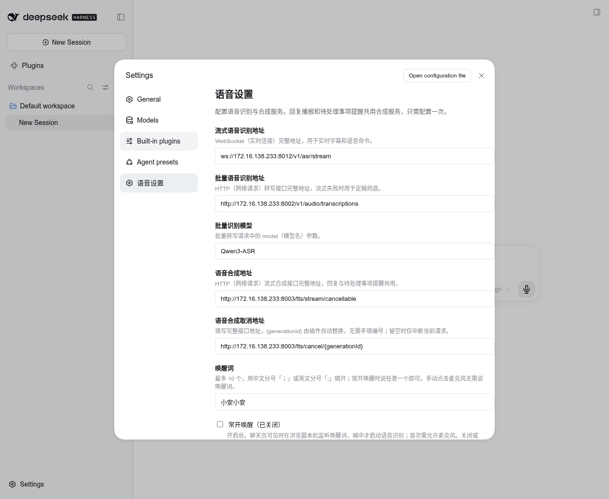
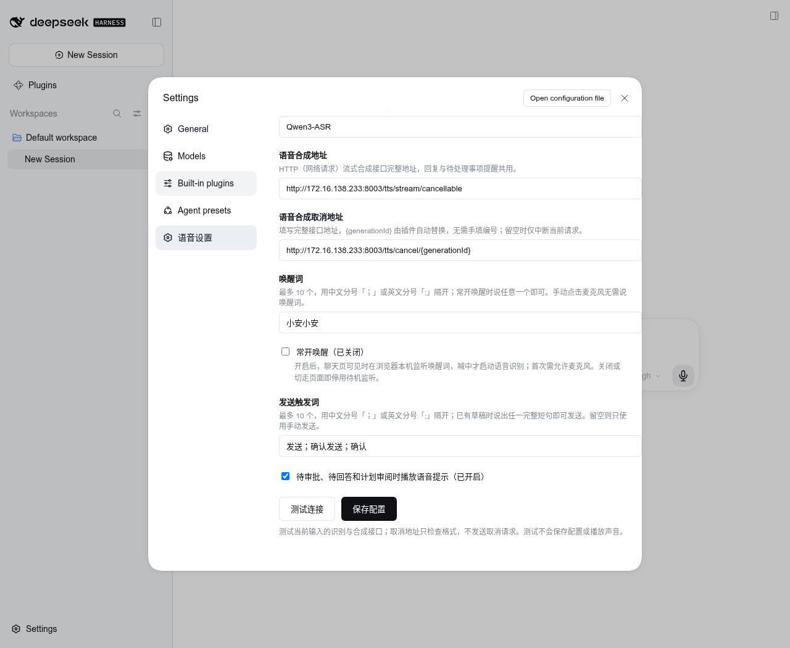

# dsh-voice-hub

DSH Web 语音交互插件，npm 包名为 `@aisoc/dsh-voice-hub`。支持语音输入、编辑识别文字和语音指令发送消息；可选唤醒词，支持连续语音对话；可自动播报助手正文的口语摘要或单次朗读完整回复，并在待审批、待回答和计划审阅时提供语音提醒。语音识别与合成服务可在设置页配置。插件基于 [qishuilalala/dsh-voice-mode](https://github.com/qishuilalala/dsh-voice-mode) `0.7.15` 改造，保留原 MIT 许可；本仓库的适配版本以 `package.json` 为准。

完整的功能与使用场景见[项目 README](http://172.16.138.233/ai-soc/ai-dsh-plugin)。





## 功能与交互

| 功能 | 当前行为 |
| --- | --- |
| 语音转文字 | 默认点击麦克风后直接录入，无需说唤醒词；实时识别文字同步显示在输入框，停顿后用定稿替换，可编辑。流式服务失败时改用批量转写。 |
| 语音确认发送 | 已有草稿时，单独说“发送”“确认发送”或“确认”可提交；启用唤醒词后也无需为发送命令重说唤醒词。发送触发词可在“语音设置”中配置多个，完整短句匹配才触发；留空可关闭语音发送。手动发送始终可用。 |
| 文字转语音 | 顶部喇叭开启后，每次主模型调用正常完成且含正文时生成一条口语摘要，默认约 30 字，包括工具调用前的正文；每条已完成的助手回复下方还有喇叭，点击朗读该条一次，再点停止。两者与麦克风开关独立。按句合成，可打断。 |
| 语音对话 | 麦克风开启后可连续说话、听回复、插话打断；模型回答仍由 DSH 已配置的对话模型生成。 |
| 常开唤醒 | 默认关闭。在“语音设置”中填写最多 10 个中文唤醒词并开启“常开唤醒”后，聊天页可见时在浏览器本地待机；说中任一唤醒词才启动 ASR。点击麦克风始终可直接录入。切走标签页或关闭页面即停止待机。 |
| 待处理事项语音提示 | DSH 出现工具审批、用户问题或计划审阅时，用同一 TTS 服务播报提示；不代替界面上的人工操作。 |
| 异常提示 | 语音状态显示在输入框上方。流式 ASR 失败显示批量兜底提示；双 ASR 失败或 TTS 失败显示中文错误，已有草稿保留。 |

语音插件提示、状态、日志以中文为主；协议名和必要英文术语使用 `WebSocket（实时连接）` 等形式说明。DSH 自身界面语言由 DSH 设置决定。

## 安装和配置

要求 Node.js 22+、支持 Web Audio 和麦克风权限的浏览器，以及 DSH `0.1.7-rc.2` 或更高版本。开发依赖锁定 DSH `0.1.7-rc.2`，使用 `npm ci --legacy-peer-deps --ignore-scripts` 恢复。常开唤醒会加载随插件提供的浏览器端关键词模型；待机音频只在本机处理，唤醒后才连接 ASR。完整对话需要在 DSH 中配置可用的对话模型凭据。

```bash
# 在本 Candidate 的 dsh-voice-hub 目录运行
npm ci --legacy-peer-deps --ignore-scripts
npm run build
dsh plugin --profile web add "$PWD" --ignore-scripts
# 重启正在运行的 DSH Web 进程
```

打开 DSH 的“设置 → 语音设置”，填写以下配置。先点“测试连接”可用当前输入值分别检查流式 ASR、批量 ASR 和 TTS，并查看每项耗时与结果；取消地址仅检查格式，不会发送取消请求。测试不会保存配置或播放声音。确认后点“保存配置”，设置写入当前 DSH HOME 下的 `voice-mode/service-config.json`。旧版服务根地址配置会在读取时转换为完整接口地址。常开唤醒和唤醒词在返回聊天页后生效；首次开启需在浏览器允许麦克风。审批提示与回复播报共用一处 TTS 合成地址。

从旧版 `dsh-voice-mode` 更新时，在 DSH Web 的插件 profile 中移除旧包并安装本目录的新包，然后重启 DSH Web。请勿同时装载两个包。现有设置、HTTP 路径 `/voice-mode`、模型缓存和浏览器诊断开关沿用旧标识；改名不会清除配置或重新下载模型。

本目录在 EXP-017 中继承 EXP-016 的摘要功能，尚未发布；既有 0.0.3 Release 不包含本次变化。安装当前目录构建产物即可启用摘要能力，卸载插件即移除；不需要修改 DSH Runtime 或构建派生镜像。已有界面截图为导入版本，新控件以实际设置页为准。

当前内网环境可按下表填写语音服务地址。设置页初始显示的 `127.0.0.1` 仅适用于语音服务与 DSH 运行在同一台机器的情况。

| 配置 | 格式 | 当前内网配置示例 |
| --- | --- | --- |
| 摘要字数 | 10–300 的整数，模型生成的目标字数 | 30 |
| 摘要模型 | 默认跟随正文的 provider/model，也可选 DSH 已配置模型 | 跟随主模型 |
| 摘要提示词 | `{length}` 替换为目标字数，保存后用于下一条摘要 | 保留结论、否定、风险与未完成状态 |
| 流式语音识别地址 | `ws://` 或 `wss://` 的完整 WebSocket 地址 | `ws://172.16.138.233:8012/v1/asr/stream` |
| 批量语音识别地址 | `http://` 或 `https://` 的完整转写接口地址 | `http://172.16.138.233:8002/v1/audio/transcriptions` |
| 批量识别模型 | `/v1/audio/transcriptions` 的 `model` 参数 | `Qwen3-ASR` |
| 语音合成地址 | `http://` 或 `https://` 的完整流式合成接口地址 | `http://172.16.138.233:8003/tts/stream/cancellable` |
| 语音合成取消地址 | 完整地址中包含 `{generationId}`；留空则只中断当前请求 | `http://172.16.138.233:8003/tts/cancel/{generationId}` |
| 唤醒词 | 常开唤醒时填写中文短语，最多 10 个、每个最多 32 字，用 `；` 或 `;` 分隔 | 留空 |
| 常开唤醒 | 开关；开启时聊天页可见期间保持本地关键词监听 | 关闭 |
| 发送触发词 | 最多 10 个、每个最多 32 字，用 `；` 或 `;` 分隔；留空则只手动发送 | 发送；确认发送；确认 |
| 待处理事项语音提示 | 开关 | 开启 |

插件直接使用四个配置的完整接口地址，不追加固定路径；取消地址中的 `{generationId}` 由插件自动替换为当前合成任务编号，无需手动填写编号。接口路径可以不同，但流式 ASR 消息、批量转写请求与响应、TTS 音频格式仍需与插件兼容。当前适配的合成接口没有音色、语速参数，因此设置页不展示这两项。当前 DSH Web 中，自动播报喇叭位于会话顶部“更多操作”左侧，单次朗读喇叭位于每条助手回复的操作区；麦克风位于输入框发送键旁，空草稿时占据操作位，输入文字后显示 DSH 的发送箭头。设置页只显示开关和文字状态；保存常开唤醒后，聊天框麦克风在本地待机时变为绿色声波图标。顶部喇叭只控制后续回复自动播报，与审批提示开关独立。

摘要通过独立辅助模型调用生成，不带主 Session 或工具，不进入原生会话历史。`speech-summary` 事件携带来源消息、回合、步骤、目标标签页和生成耗时；该文字原样送入 TTS。`voiceMode.follow` 与 `session.follow` 共用 `/api/remote.mux` WebSocket，下行音频和状态也使用这一连接，不再提供 `/voice-mode/stream` SSE。上行识别和配置接口保持 HTTP/WebSocket 各自用途。

同一会话按顺序生成摘要并合成音频，两级队列流水执行。同回合下一步不会取消前一条；新回合、打断、关闭自动播报、切换会话、连接断开或卸载会取消未完成任务并丢弃迟到结果。摘要失败时显示简短提示并跳过，主回合照常继续；重连不补播历史。单条回复的手动朗读仍读完整正文。

摘要调用单独按模型公开能力选择关闭思考档位；不支持关闭时使用已声明的最低强度，未知能力不猜测厂商参数。`speech-summary.reasoningMode` 区分 `off-requested`、`minimum`、`unknown`，只表示请求策略，不把隐藏推理或缺少推理内容当作已经关闭。主会话继续使用原有有效设置。当前本地 Qwen 路由补齐 `qwen-chat-template` 兼容声明，并保留其服务端既有 `xhigh` 默认值；只有摘要请求选择 `off`。新增模型复用 DSH 的模型能力与协议适配，未知接入需先核对服务端合同。

每项摘要的总时限为 15 秒，包含排队；输出预算为目标字数的四倍且至少 128 token，再受模型配置上限约束。成功 `finish` 后即可发布摘要，不等待无关的连接收尾。超时或失败会提示并跳过，不阻塞后续摘要。

远程 TTS 按 24 kHz 单声道 PCM16 流式转发，并请求 `Accept-Encoding: identity`，避免 HTTP gzip 压缩层缓存首段。浏览器 Web Audio 收到对齐采样后起播，不等整句合成结束。首包等待上限 10 秒，流中连续无数据上限 5 秒；自动摘要不做多轮重试，已经发声的流失败后不重播整句。PCM 不可直接播放的浏览器保留收齐后生成 WAV 的后备路径。`epoch`、句序号、块序号与来源消息随音频传输，打断后旧代次不会重新播放。

启用现有 `dsh-voice-mode.telemetry` 后，诊断区分主流收尾、消息提交、摘要排队/生成、TTS 排队/首包与摘要到浏览器起播。服务端和客户端各自使用单调时钟，浏览器起播按音频时钟及输出延迟对齐；测试音调和播放 API 不能证明物理扬声器听感。

字数是模型目标，不强行截断句子。每条摘要增加一次模型调用的费用和等待时间；真实模型的语义保真、字数偏差与播报延迟需要单独评估。

## 验证

摘要功能的受控实例验证使用 `test/runtime-summary-probe.ts` 和 `test/runtime-summary-browser.ts`，不需要真实模型凭据。前者仅装载到隔离 DSH 实例，提供确定性模型、可延迟或失败的辅助调用以及 PCM 测试音调；后者检查实际设置页、共用连接、音频解码、取消和历史冷加载。先按本仓库 `runtime/adapters/dsh-container/prepare-verification-home.mjs` 初始化一次性 HOME，以锁定标准镜像装载当前 `lib/` 与 `assets/` 只读卷，再在该实例的 Web profile 中插入探针，并将主模型设置为 `voice-probe/main`。探针模块的 DSH 依赖须解析到同一 Runtime 安装，插件的其余运行依赖由锁文件恢复。

测试配置使用 `ttsEngine: remote`、`asrEngine: remote`、`ttsStreamUrl: http://127.0.0.1:3386/voice-probe/tts`、`ttsCancelUrl: http://127.0.0.1:3386/voice-probe/cancel/{generationId}`，并关闭 `session-title-llm`。编译产物放到仓库外的临时目录，避免进入 Candidate 摘要；浏览器产物所在目录需能解析当前 `playwright-core` 依赖。

```bash
node node_modules/esbuild/bin/esbuild test/runtime-summary-probe.ts --bundle --platform=node --format=esm --packages=external --outfile=/tmp/voice-summary-runtime/probe/probe.mjs
node node_modules/esbuild/bin/esbuild test/runtime-summary-browser.ts --bundle --platform=node --format=esm --packages=external --outfile=/tmp/voice-summary-runtime/browser.mjs
node /tmp/voice-summary-runtime/browser.mjs voice-summary-exp016 http://127.0.0.1:3386 /tmp/voice-summary-runtime/evidence/live live
# 重启隔离实例后检查历史，不回放摘要
node /tmp/voice-summary-runtime/browser.mjs voice-summary-exp016 http://127.0.0.1:3386 /tmp/voice-summary-runtime/evidence/cold cold
# 移除 voice-mode profile 条目并重启后检查无插件；恢复条目并重启后检查实际卸载
node /tmp/voice-summary-runtime/browser.mjs voice-summary-exp016 http://127.0.0.1:3386 /tmp/voice-summary-runtime/evidence/absent absent
node /tmp/voice-summary-runtime/browser.mjs voice-summary-exp016 http://127.0.0.1:3386 /tmp/voice-summary-runtime/evidence/unload unload
```

四种模式按注释切换实例状态后分别运行；`unload` 在该隔离实例中直接处置 Cordis 插件，验证卸载清理而非插件管理页操作。复现所用镜像、参数、只读挂载和 profile 补丁保存在对应 Run 的 `evidence/runtime.json` 与 `evidence/installed.patch.yml`。探针只返回固定摘要和音调，不能验证真实模型语义、约 30 字目标的达成率或真实语音听感。下方 `verify:product` 使用浮动的 `@next`，不作为本次锁定 Runtime 的摘要验证依据。

`test/reasoning-wire-probe.mjs` 接受锁定镜像内 pi-ai `dist/api/openai-completions.js` 路径和 DSH `packages/llm/llm-deepseek/lib` 路径，截获真实 SDK 与官方 DeepSeek 适配器的请求，检查各协议关闭思考及主调用默认值，全程不访问模型网络。

真实 DeepSeek 文本比较使用 `node test/deepseek-summary-bench.mjs <原版 speech-summary.ts> <Agent evaluation.md> <本地 *.llm-api-key> <证据 JSON>`。脚本读取 U-VOICE-004 的三类事实，各重复三次并交替执行顺序，调用实际原版/整改版摘要队列；模型 HTTP 接口是外部边界，不能替代 Runtime 装载或 TTS 听感验收。原版另设 45 秒测试看门狗，整改版沿用 15 秒总时限，超时样本不作为成功生成耗时统计。证据只含可见摘要、请求策略、耗时和推理数量，不保存凭据或推理正文。

以下集成检查默认连接本机 `8012`、`8002`、`8003` 端口。服务位于其他机器时，先设置 `DSHVM_ASR_STREAM_URL`、`DSHVM_ASR_BATCH_URL`、`DSHVM_TTS_STREAM_URL` 和 `DSHVM_TTS_CANCEL_URL` 环境变量，值均为完整接口地址。在插件目录运行：

```bash
npm run typecheck
npm run build
npm test
node test/remote-services.integration.mjs
```

`remote-services.integration.mjs` 会访问所配置的真实语音服务：先合成测试语句，再将音频送入流式 ASR，核对返回文字。要单独验证批量识别接管，可运行：

```bash
DSHVM_ASR_STREAM_URL=ws://127.0.0.1:1/v1/asr/stream node test/remote-services.integration.mjs
```

完整浏览器闭环可运行：

```bash
npm run verify:product
```

该命令安装当前 `@deepseek-ai/dsh@next` 到一次性目录，启动隔离 Web 实例，并用 Chrome 虚拟麦克风播放真实合成语音。检查语音转写、确认发送、唤醒后独立说自定义发送触发词、会话播报开关、审批提示音频解码和 ASR 双服务不可用时的中文提示；最后把 npm tarball 装入另一隔离 profile，确认插件能够激活。结束时删除隔离实例和临时令牌。需要本机有 `/usr/bin/google-chrome`，其他位置可设置 `DSHVM_CHROME`。测试会向隔离 DSH 发送语音消息；没有对话模型凭据时，模型回合会显示凭据缺失，语音插件的上述链路仍可验证。

人工验收时，保持“常开唤醒”关闭，点击麦克风直接说一段话，停顿后检查草稿可编辑，单独说“确认发送”，确认消息发送且命令词未出现。然后配置“小安小安；你好小安”并开启“常开唤醒”，返回聊天页等待状态条显示“常开唤醒中”，不点麦克风，先说其中任一唤醒词、再说指令；再次点击麦克风应无需唤醒词即可直接录入。切换标签页应停止待机。最后验证回复播报、真实工具审批、用户问题和计划审阅。

## 边界

自动播报真实模型回复与真实工具审批的效果依赖 DSH 中已配置的对话模型、工具权限以及浏览器音频输出。仓库自带的隔离验证使用审批提示事件检验合成和浏览器播放通道，无法替代带真实模型凭据的人工对话验收。浏览器麦克风、音频输出设备和 talk-sdk 服务的可用性也应在目标环境复核。

常开唤醒使用 talk-sdk 的 sherpa-onnx WASM 资源，来源为 `talk-sdk` 提交 `e2d4dd5`；第三方声明和文件摘要保存在 `assets/kws/`。上游仍将该关键词模型的商用许可确认列为待办，商用交付前需确认模型权重许可或替换模型。
